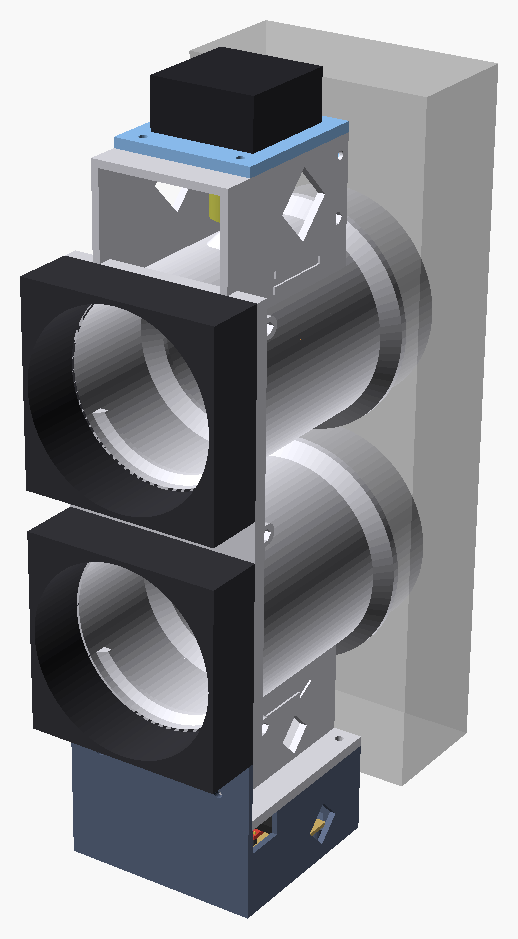
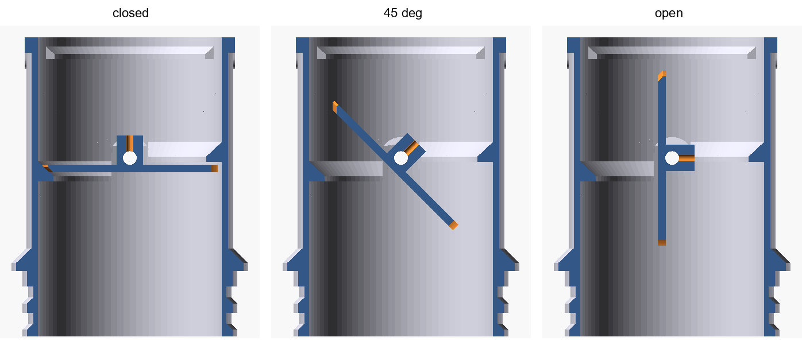
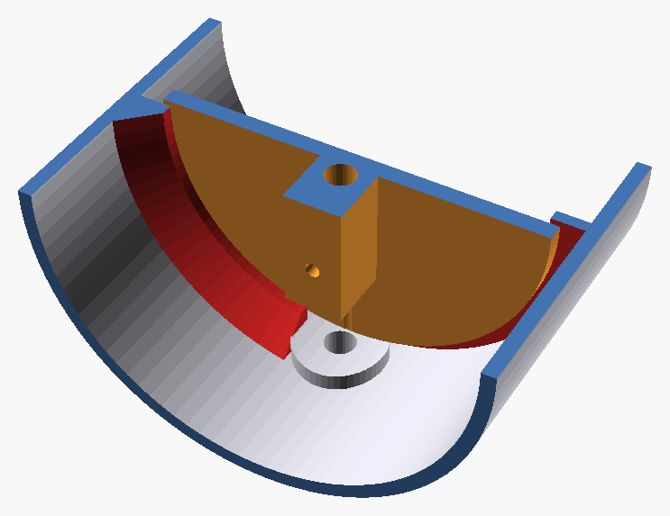
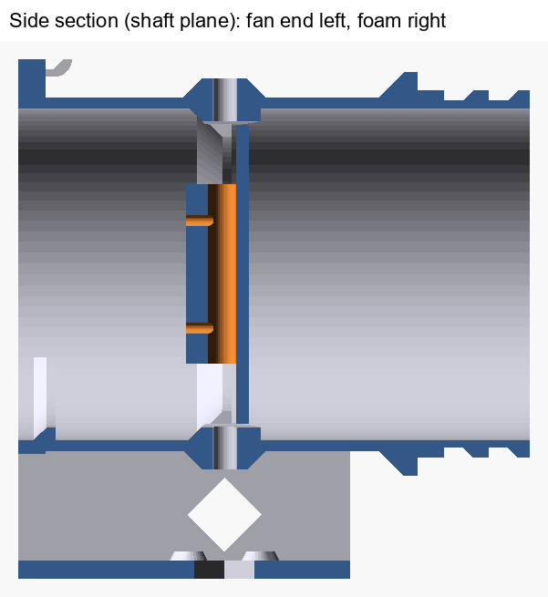
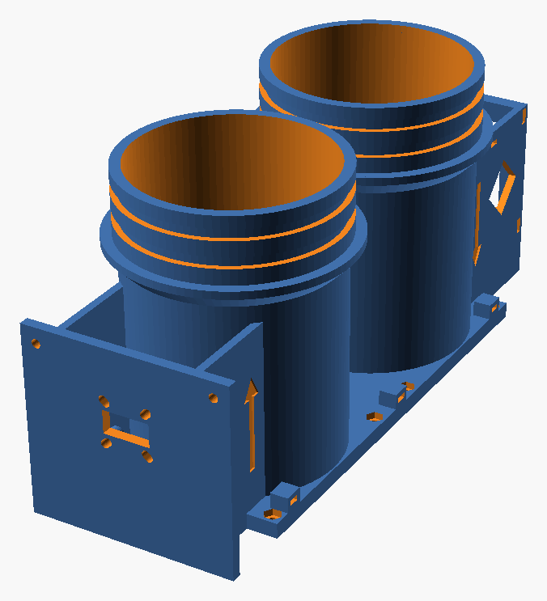
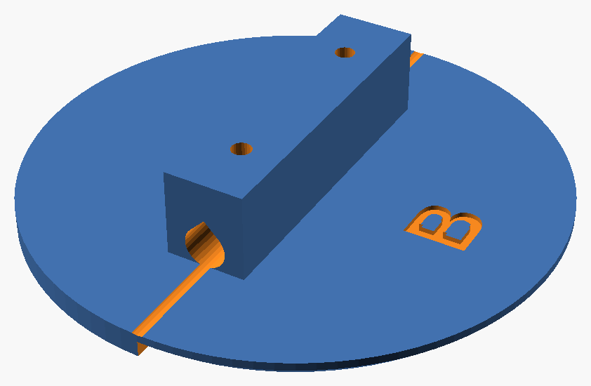
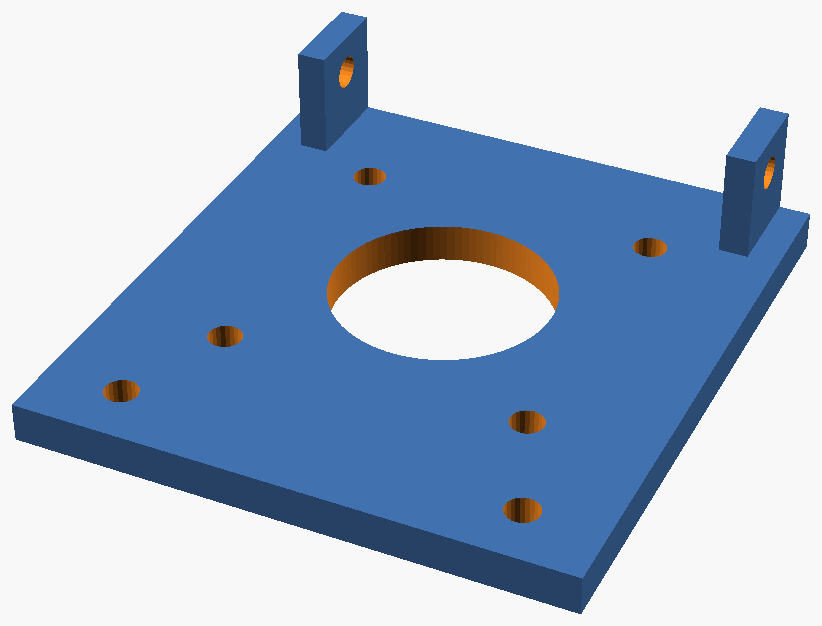
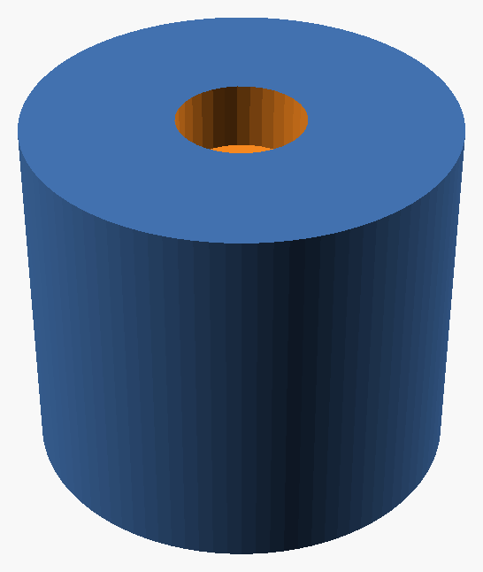

# Window vent

A demand-controlled window ventilator for one room. Two 80 mm fans move air through a foam window insert: one brings fresh air in, the other exhausts stale air. A single butterfly-damper housing closes both holes with one shaft, turned by a silent stepper motor. An ESP32 reads a CO₂ sensor and runs the fans and the damper.

There is no heat recovery: every litre of air exhausted is lost heat. In exchange it is simple, cheap and automatic. See the estimates below.

> **Status: early prototype, not built.** The geometry is checked in CAD (closed solids, the discs swing freely, the lips stop them). Nothing has been printed or tested yet.

<p align="center">
  
</p>

## How it works

- **Foam insert.** A block of 2 in (51 mm) XPS foam fills the window gap (100 mm or less, so a child can't fit through). Two 82 mm holes, stacked vertically: intake on top, exhaust below. An insect screen covers the outdoor face.
- **Damper housing.** It sits on the **room** face of the foam, so its moving parts stay warm and dry (no ice). Its two spigots slide into the foam holes and seal with two O-rings each. The housing comes out in spring, and the foam insert stays reusable.
- **Butterfly dampers.** One vertical 5 mm steel shaft runs through both ducts and carries a disc in each. A quarter turn opens or closes both. Each disc closes against two half-ring lips lined with thin foam tape, one on each side of the shaft.
- **Motor and encoder.** A NEMA 17 pancake stepper on top turns the shaft through a flexible coupler. A TMC2209 driver keeps it silent. The motor screws to a separate plate on the bench, and the plate then screws onto a frame on top of the housing from above. An AS5600 magnetic encoder at the bottom reads the absolute shaft angle, so the firmware always knows whether the dampers are really closed, with no homing and no limit switch.
- **Fans.** Two 80 mm PWM fans screw onto the room end of the housing.
- **Water stays out of the room.** A 3 mm drip dam across the lower part of each bore, just before the fan, stops droplets from running indoors. Around the bottom shaft hole in each duct, a 16 mm boss rises 3 mm above the floor, so water flows around it instead of down the shaft.
- **How it seals.** The lips do the sealing, not the gap between the disc and the bore: they are 5.6 mm wide and overlap the disc edge by 2 mm, with foam tape in between. The disc is 67 mm in a 74 mm bore so it can be slid in edge-on past the dam and the bosses. Around the shaft, where the lips must stop to clear the hub, a boss at the top and the one at the bottom close the gap. Their inner faces are curved, coaxial with the bore, so they follow the disc edge with an even gap of about 0.75 mm.

<p align="center">
  
</p>

<p align="center">
  
</p>

<p align="center">
  
</p>

<p align="center">
  
</p>

## Estimates (one sleeper)

| Airflow (each way) | CO₂ in the room | Heat lost at −20 °C outdoors |
|---|---|---|
| 5 L/s (11 CFM) | ~1000 ppm | ~250 W |
| 8 L/s (17 CFM) | ~800 ppm | ~400 W |
| 11 L/s (23 CFM) | ~700 ppm | ~540 W |

At 8 L/s, roughly 10 hours a day over a cold-climate heating season (about 200 days, electricity at 7–11 ¢/kWh), the lost heat costs about $35–45. The fans use about 1 W each.

## Printed parts

| Part | Qty | Description | Size (mm) | Print orientation | |
|---|---|---|---|---|---|
| `body` | 1 | Housing: two ducts with the damper lips, drip dams and shaft bosses, O-ring spigots, fan plate, motor frame and encoder plate | 90 × 233 × 114 | Fan plate on the bed, no supports |  |
| `disc` | 2 | Butterfly damper disc, clamped to the shaft by two M3 grub screws | 67 × 67 × 14 | Plate on the bed, hub up |  |
| `motor_plate` | 1 | The motor screws to it on the bench; it then screws onto the frame on top of the housing | 56 × 56 × 4 | Flat |  |
| `magnet_cap` | 1 | Holds the encoder magnet on the bottom end of the shaft | 10 × 10 × 7 | Bore down |  |

PETG. The foam-side lip in each bore seals with its underside, so it prints as a flat 5.6 mm overhang. If it sags, paint a support enforcer under those two half-rings only; the foam tape covers the face anyway.

## Hardware

Prices: Amazon.ca, October 2026, before taxes. Packs of two leave a spare.

| Item | Qty | Notes | Price (CAD) |
|---|---|---|---|
| 80 mm PWM fan, ≥ 2 mm H₂O static pressure | 2 | Noctua NF-A8 PWM (2.37 mm H₂O, 17.7 dB(A) max). Run at 30–60% | 2 × $24.95 |
| Stepper motor, NEMA 17 pancake | 1 | StepperOnline 17HS08-1004S (42 × 42 × 20 mm, 5 mm shaft, 13 N·cm). Any NEMA 17 fits the mount | $26.50 |
| TMC2209 stepper driver | 1 | StealthChop for silent moves; UART for StallGuard | $16.99 (pack of 2) |
| AS5600 magnetic encoder board + **diametric** magnet | 1 | Sold with the magnet. Board screws or zip-ties to the bottom plate. See the magnet note below | $12.69 (pack of 2) |
| ESP32 dev board | 1 | Any ESP32; an ESP32-S3-WROOM-1 board works | — |
| CO₂ sensor, NDIR | 1 | Sensirion SCD40 module (CO₂ + temperature + humidity, I²C). Not CCS811/SGP30 ("eCO₂" estimates) | $37.45 |
| Steel rod, 5 mm × 200 mm | 1 | Damper shaft. 200 mm fits as is, no cutting. If it is HSS (very hard), grind a small flat with a rotary tool where each disc and the coupler clamp, so the screws can't slip | $12.79 (pack of 2) |
| Flexible shaft coupler, 5–5 mm, 19 × 25 mm | 1 | | $13.49 (pack of 2) |
| M3 × 35 screws + M3 nuts | 8 each | Fans | — |
| M3 × 8 screws | 4 | Motor to motor plate | — |
| M3 × 10 screws + M3 nuts | 4 each | Motor plate to the housing (nuts slide into side slots in the frame) | — |
| M3 grub screws | 4 | Two per disc, 24 mm apart along the hub, so the disc can't rock on the shaft (self-tapping into the hub) | — |
| O-rings, about 76 × 2.5 mm, EPDM or silicone | 4 | Two per spigot. Optional at first: the spigots also fit a snug hole | — |
| Thin foam tape, about 1 mm | 1 roll | Lips | |
| 12 V supply | 1 | Fans and motor | — |
| **Total bought** | | Not counting the foam insert, O-rings and foam tape | **≈ $170** |

### The encoder magnet

The AS5600 measures the direction of the magnetic field across the shaft, so the magnet's north-south axis must lie **across** the shaft and turn with it.

- A **diametric** magnet (magnetized across its diameter) does this lying flat on the shaft end. AS5600 boards are usually sold with one, typically 6 × 2.5 mm (some kits 6 × 3 mm). This is the default (`magnet = "diametric"`); set `magnet_d` and `magnet_h` to the one you have.
- An ordinary small cylinder magnet is usually **axial** (poles on its flat ends). Lying flat it would not work, but lying on its side it does: set `magnet = "sideways"` for a cap that holds a 2 × 2 mm cylinder across the shaft. A magnet that small may be too weak at 1–2 mm; the AS5600's status register reports "too weak / OK / too strong", so check it once.
- Without any magnet, the TMC2209's StallGuard can find "closed" by sensing the stall against the lips.

## Assembly

1. Line the lips with foam tape.
2. Slide each disc edge-on into its duct from the fan end, hub toward the room.
3. Push the shaft down through the frame on top, both ducts and both disc hubs.
4. Turn both discs closed against the lips and tighten their grub screws (two per disc) through the duct openings.
5. Glue the magnet into the cap and press the cap onto the shaft's bottom end. Fit the AS5600 board under it, 1–2 mm from the magnet.
6. On the bench, screw the motor to the motor plate (4 × M3 × 8 from below) and fit the coupler on the motor shaft.
7. Slide four M3 nuts into the side slots of the frame on top of the housing. Lower the motor and plate onto the frame, with the coupler over the shaft end, and screw the plate down (4 × M3 × 10 from above). Tighten the coupler's lower screw through a side window.
8. Fit the fans: the top one blowing into the room, the bottom one blowing toward the window.
9. Roll two O-rings onto each spigot and push the housing into the foam holes.

## Files

```
images/                renders used in this README
cad/window_vent.scad   parametric model (Customizer; part = "assembly" for the preview)
stl/                   exported parts (default parameters)
tools/check.py         geometry checks (must print ALL CHECKS PASSED)
```

## License

Copyright (c) 2026 Marc-Antoine Massicotte.

This design (CAD model, STL files, images, documentation and scripts) is released under the [CERN Open Hardware Licence Version 2 - Permissive](LICENSE) (CERN-OHL-P-2.0). You may use, modify, make, share and sell it freely, as long as you keep this notice. It comes with no warranty of any kind, and the author accepts no liability for its use.
