# Window vent

A demand-controlled window ventilator for one room. Two 80 mm fans move air through a foam window insert: one brings fresh air in, the other exhausts stale air. A single butterfly-damper housing closes both holes with one shaft, turned by a silent stepper motor. An ESP32 reads a CO₂ sensor and runs the fans and the damper.

There is no heat recovery: every litre of air exhausted is lost heat. In exchange it is simple, cheap and automatic. See the estimates below.

> **Status: early prototype, not built.** The geometry is checked in CAD (closed solids, the discs swing freely, the lips stop them). Nothing has been printed or tested yet.

<p align="center">
  
</p>

## How it works

- **Foam insert.** A block of 2 in (51 mm) XPS foam, 30 psi grade, fills the window gap (100 mm or less, so a child can't fit through). Two 83 mm holes (a 3-1/4 in hole saw, see [drilling](#drilling-the-foam-insert)), stacked vertically: intake on top, exhaust below. An insect screen covers the outdoor face.
- **Damper housing.** It sits on the **room** face of the foam, so its moving parts stay warm and dry (no ice). Its two spigots fit snugly in the foam holes; two O-rings on each are optional, for a hole that comes out loose. The housing comes out in spring, and the foam insert stays reusable.
- **Butterfly dampers.** One vertical 5 mm steel shaft runs through both ducts and carries a disc in each. A quarter turn opens or closes both. Each disc closes against two half-ring lips lined with thin foam, one on each side of the shaft. One lip is flat; the other is a 45° cone, and the half of the disc that closes against it (engraved B) has a matching 45° bevel, so neither prints as a flat overhang.
- **Motor and encoder.** A NEMA 17 pancake stepper on top turns the shaft through a flexible coupler. A TMC2209 driver keeps it silent. The motor screws to a separate plate on the bench, and the plate then screws onto a frame on top of the housing from above. An AS5600 magnetic encoder at the bottom reads the absolute shaft angle, so the firmware always knows whether the dampers are really closed, with no homing and no limit switch.
- **Fans.** Two 80 mm PWM fans screw onto the room end of the housing.
- **Electronics box.** A tray under the housing holds a 5 × 7 cm perfboard with the ESP32 and the TMC2209 soldered on. The encoder plate is its lid, and its front wall rises to close the front of the bottom bay. The cables run down the right side (seen from the room), hidden behind the fans and held by three tie-wrap anchors on the back of the fan plate; the same anchors and a cable entry on the left side allow the mirror image. Power comes from two plug-in adapters: a 12 V brick for the fans and the motor, whose wire comes in with the other cables, and a 5 V USB-C adapter for the ESP32, whose cable passes through a diamond opening in the left wall. The [layout drawing](doc/ebox_layout.svg) shows where everything goes on the perfboard.
- **Water stays out of the room.** A 3 mm drip dam across the lower part of each bore, just before the fan, stops droplets from running indoors. Around the bottom shaft hole in each duct, a 16 mm boss rises 3 mm above the floor, so water flows around it instead of down the shaft.
- **How it seals.** The lips do the sealing, not the gap between the disc and the bore: the flat lip is 5.6 mm wide and overlaps the disc edge by 2 mm, and the conical lip meets the disc's bevelled rim over a band about 4 mm wide, with foam tape in between. The disc is 67 mm in a 74 mm bore so it can be slid in edge-on past the dam and the bosses. Around the shaft, where the lips must stop to clear the hub, a boss at the top and the one at the bottom close the gap. Their inner faces are curved, coaxial with the bore, so they follow the disc edge with an even gap of about 0.75 mm.

<p align="center">
  
</p>

<p align="center">
  
</p>

<p align="center">
  
</p>

<p align="center">
  
</p>

## Estimates (one sleeper)

| Airflow (each way) | CO₂ in the room | Heat lost at −20 °C outdoors |
|---|---|---|
| 5 L/s (11 CFM) | ~1000 ppm | ~250 W |
| 8 L/s (17 CFM) | ~800 ppm | ~400 W |
| 11 L/s (23 CFM) | ~700 ppm | ~540 W |

At 8 L/s, roughly 10 hours a day over a cold-climate heating season (about 200 days, electricity at 7–11 ¢/kWh), the lost heat costs about $35–45. The fans use about 1 W each.

## Printed parts

| Part | <div style="width:180px">Thumbnail</div> | Qty | Description | Size (mm) | Print orientation |
|---|:---:|---|---|---|---|
| `body` |  | 1 | Housing: two ducts with the damper lips, drip dams and shaft bosses, spigots for the foam, fan plate, motor frame and encoder plate | 90 × 241 × 114 | Fan plate on the bed, no supports |
| `disc` |  | 2 | Butterfly damper disc, clamped to the shaft by two M3 grub screws; the half engraved B has a 45° bevel on its rim | 67 × 67 × 14 | Plate on the bed, hub up |
| `motor_plate` |  | 1 | The motor screws to it on the bench; it then sits on top of the housing: two screws in front of the motor, and two tabs at the back, down through the frame and screwed to the tower walls | 56 × 61 × 15 | Top face on the bed, tabs up |
| `magnet_cap` |  | 1 | Holds the encoder magnet on the bottom end of the shaft; one M3 grub screw, height adjustable ±1 mm | 14 × 14 × 12 | Bore down |
| `ebox` | 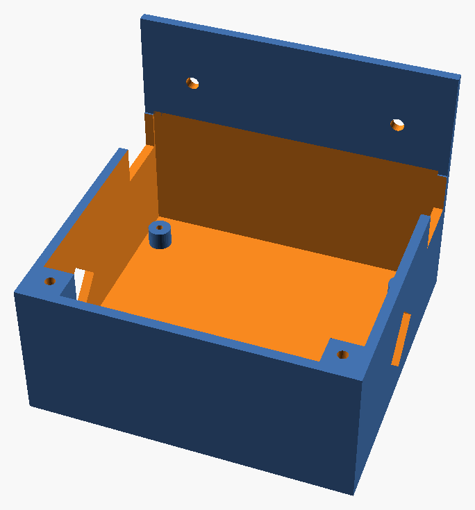 | 1 | Electronics box under the housing; its front wall also covers the front of the bottom bay, and two back tabs screw to the bay walls | 80 × 76 × 64 | Floor on the bed |

**For a 180 mm printer** (e.g. Bambu Lab A1 mini), print the housing in two halves instead of `body`. The cut runs midway between the two ducts, where only the fan plate joins them; a small splice plate behind the fan plate joins the halves again with four M3 screws, driven from the fan side in the band between the two fans. Each half prints like the full housing, in about half the time (roughly 5–6 h), so they can go on different days; use the same spool and profile for both.

| Part | <div style="width:180px">Thumbnail</div> | Qty | Description | Size (mm) | Print orientation |
|---|:---:|---|---|---|---|
| `body_top` | 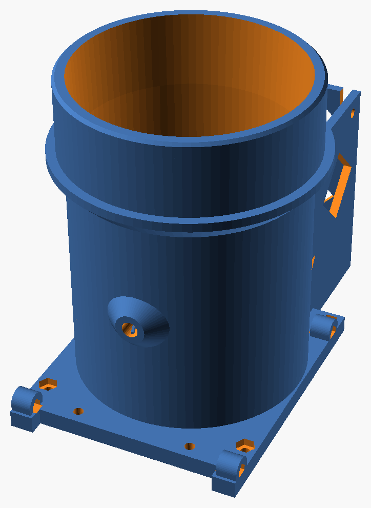 | 1 | Upper half: intake duct, upper fan, motor frame, and both middle tie-wrap anchors (whole) | 90 × 130 × 114 | Fan plate on the bed, no supports |
| `body_bottom` | 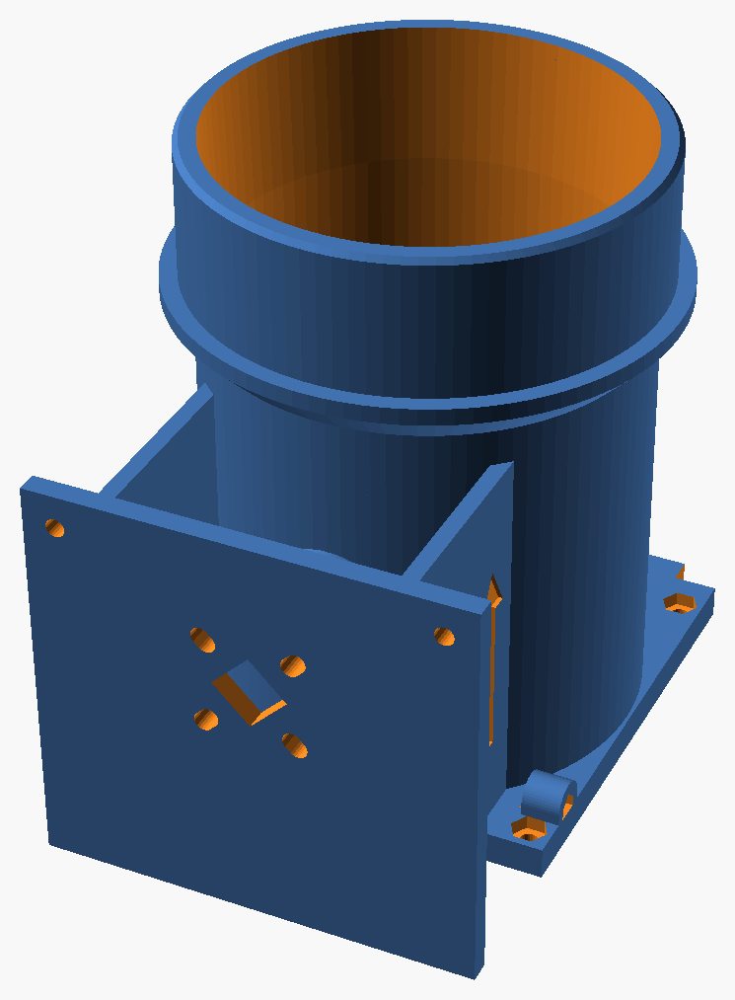 | 1 | Lower half: exhaust duct, lower fan, encoder plate; notched under the two middle anchors | 90 × 116 × 114 | Fan plate on the bed, no supports |
| `splice` | 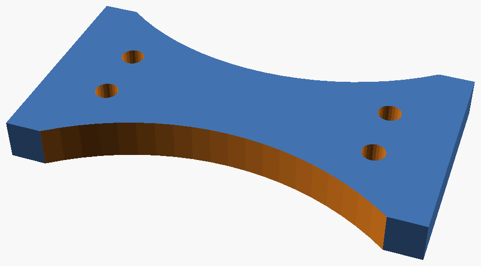 | 1 | Joins the halves behind the fan plate; four M3 nut pockets on its back | 60 × 32 × 6 | Flat, nut pockets up |

<p align="center">
  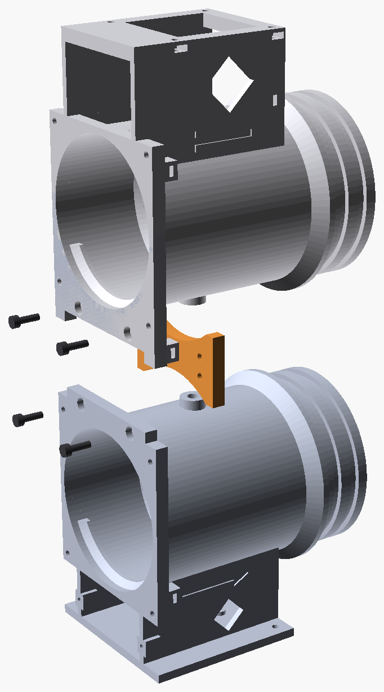
</p>

**Optional test prints, before the housing.** Print the small real parts first (discs, motor plate, magnet cap, about 1.5–2 h): they test the rod, the grub screws, the motor and the magnet. Then:

| Part | <div style="width:180px">Thumbnail</div> | Size (mm) | Time | What it tests |
|---|:---:|---|---|---|
| `fittest` | 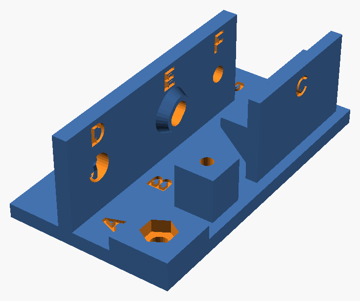 | 60 × 34 × 22 | about 20–30 min | The housing's printer-sensitive features, in its print orientation, engraved A to G (see below) |
| `oring_test` | 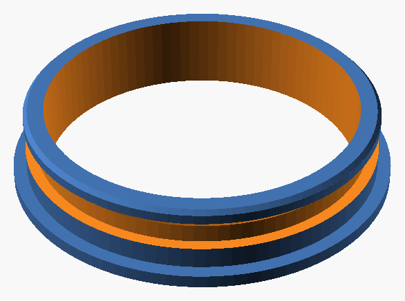 | Ø 90 × 18 | about 30 min | One spigot section (with an O-ring groove): push it into a test hole cut in a foam scrap, bare first; if it's loose, try it with an O-ring |

**The fit-test coupon.** It copies seven features of the housing that depend most on the printer: holes and a slot, a nut pocket, a pilot for self-tapping screws, the conical lip's 45° ledge and a countersink. Each is engraved with a letter, A to G. Print it with the housing's filament and settings, then check each feature against the table below: if one fails, adjust the slicer (or the hole sizes in the model) before starting the 9–12 hour housing print.

<p align="center">
  
</p>

| | Feature | Copied from | Pass if |
|---|---|---|---|
| A | M3 hole + nut pocket | fan plate | the nut drops in and stays; an M3 screw passes freely |
| B | Ø 2.5 self-tapping pilot | the box cover bosses | an M3 screw cuts a firm thread without splitting the post |
| C | 5.6 mm ledge with a 45° underside (on the back of the plate) | conical lip B in each bore | the slope is smooth, not drooping or stringy |
| D | Ø 5.4 shaft hole, horizontal, with its sacrificial fin | bearing holes in the duct walls | the top of the hole stays round; after drilling the fin out (see below), the 5 mm rod turns freely |
| E | AS5600 diagonal slot (3.5 wide) on a 2 mm standoff | encoder plate | an M3 screw passes at both ends of the slot |
| F | M3 hole, horizontal | motor frame | an M3 screw passes freely |
| G | M3 hole with a 90° countersink, opening on the bed | split housing joint (`body_top` and `body_bottom`) | an M3 flat-head screw sits flush or just below the surface |


PETG. No support is needed anywhere: every face that looks down when printing (the lip B seat, the disc bevel, the boss sides, the O-ring grooves, the countersinks) slopes at 45° or less.

### Filament

About **0.4–0.45 kg of PETG** for one unit (less than half a 1 kg spool), or roughly $11–16 at $25–35/kg.

| Part | Qty | Solid volume |
|---|---|---|
| `body` | 1 | 264 cm³ |
| `disc` | 2 | 2 × 14 = 28 cm³ |
| `motor_plate` | 1 | 12.5 cm³ |
| `magnet_cap` | 1 | 1.6 cm³ |
| `ebox` | 1 | 47 cm³ |
| **Total** | | **≈ 353 cm³** |

The split housing (`body_top` 127 cm³, `body_bottom` 136 cm³, `splice` 8 cm³) adds about 7 cm³ (10 g).

- Printed fully solid, 353 cm³ of PETG (1.27 g/cm³) weighs about 448 g.
- Infill hardly matters: almost every wall, plate, lip and disc is 6 mm thick or less, so with 4–6 perimeters the slicer prints it solid anyway. Expect about 400–450 g, plus a little for the skirt or brim and purging.
- The optional test prints add about 30 cm³ (37 g): `fittest` 12 cm³, `oring_test` 18 cm³. The optional `drill_guide` adds 9 cm³ (11 g).
- Print time: very roughly 9–12 hours for the housing on a Bambu Lab P1 (0.2 mm layers; about 7–9 hours at 0.28 mm), and about 3–4 hours for all the other parts together. The slicer gives the exact figures.

### Slicer settings

Most parts are thin, so the number of walls (Bambu Studio: Strength → **Wall loops**) matters more than the infill percentage: with enough walls, the thin parts come out solid and the infill only fills the few thicker zones.

| Part | Wall loops | Sparse infill | Why |
|---|---|---|---|
| `body` (or `body_top` and `body_bottom`) | 4 | 25 % | Thin walls everywhere; the infill only reaches the thick zones (bosses, spigot roots, fan plate). No supports: a sacrificial fin holds up the top of each of its four shaft holes (see below) |
| `disc` | 5 | 40 % | The grub screws thread into the hub: 5 loops leave about 2 mm of solid plastic around each hole |
| `motor_plate` | 5 | 40 % | Screw holes, bosses and tabs under clamping load |
| `magnet_cap` | | 100 % | Tiny, with a grub screw in it: print it solid |
| `splice` | 5 | 40 % | Joins the two halves: nut pockets and countersunk screws |
| `ebox` | 4 | 15–20 % | No real loads; a 4th wall (same print time) makes the walls around the screw holes stronger |
| `fittest`, `oring_test` | 4 | 25 % | As the housing, so they test what the housing will be |
| `drill_guide` | 4 | 40 % | Small; 4 walls make the bushings solid |
| `louver_chassis` | 3 | 20 % | Light load |
| `louver_blade` | 3 | 15 % | Thin and light; their pins come out solid anyway |
| `louver_link`, `louver_retainer` | | 100 % | Small and thin |

- **Infill pattern: gyroid.** Equally strong in every direction, and it prints smoothly in PETG.
- **Top and bottom shell layers: 5.** Flat faces stay smooth and the infill doesn't show through.
- **Supports: none.** Every part is designed to print without them. The housing's four shaft holes print horizontal, so each one carries a sacrificial fin: a thin lattice of X's (0.8 mm, two nozzle lines; `fin_t` in the model, 0 for none) standing on the bottom of the hole and holding up its top, with 1.5 mm clear at each end. After printing, drill the fins out by hand with a 5.4 mm bit (a #3 number drill is 5.41 mm; 5.5 mm also works): the bit enters the clear end first, sits square, and cuts the fin easily. Feature D of `fittest` is the same hole with the same fin, and `fin_test` is a 10-minute block with two of them.

## Hardware

Prices: Amazon.ca, October 2026, before taxes. Packs of two leave a spare.

| Item | Qty | Notes | Price (CAD) |
|---|---|---|---|
| 80 mm PWM fan, ≥ 2 mm H₂O static pressure | 2 | Noctua NF-A8 PWM (2.37 mm H₂O, 17.7 dB(A) max). Run at 30–60% | 2 × $24.95 |
| Stepper motor, NEMA 17 pancake | 1 | StepperOnline 17HS08-1004S (42 × 42 × 20 mm, 5 mm shaft, 13 N·cm). Any NEMA 17 fits the mount | $26.50 |
| TMC2209 stepper driver | 1 | StealthChop for silent moves; UART for StallGuard | $16.99 (pack of 2) |
| AS5600 magnetic encoder board + **diametric** magnet | 1 | Sold with the magnet (the kit: 23.3 × 22.8 mm board, 3.95 × 2 mm magnet). A 20 × 20 board with 15 mm hole spacing also fits: 4 × M3 × 12 + nuts onto standoff pads on the bottom plate. See the magnet note below | $12.69 (pack of 2) |
| ESP32-S3 dev board | 1 | Freenove ESP32-S3-WROOM Lite (FNK0099), the board the firmware's pinout is written for; other ESP32-S3-WROOM-1 boards work with a pin check. Flash it over USB on the bench; the final firmware updates over Wi-Fi | — |
| CO₂ sensor, NDIR | 1 | Sensirion SCD40 module (CO₂ + temperature + humidity, I²C). Not CCS811/SGP30 ("eCO₂" estimates) | $37.45 |
| DS18B20 temperature probe, waterproof | 1 (+1 optional) | Outdoor air: the 6 mm stainless probe on its cable goes through the foam insert, above the intake ([template](#drilling-the-foam-insert)). A second one, indoors on an inside wall, is optional: the SCD40 already reads the room's temperature | — |
| Steel rod, 5 mm × 200 mm | 1 | Damper shaft. 200 mm fits as is, no cutting. If it is HSS (very hard), grind a small flat with a rotary tool where each disc and the coupler clamp, so the screws can't slip | $12.79 (pack of 2) |
| Flexible shaft coupler, 5–5 mm, 19 × 25 mm | 1 | | $13.49 (pack of 2) |
| M3 × 35 screws + M3 nuts | 8 each | Fans | — |
| M3 × 8 screws | 4 | Motor to motor plate, through the bosses under the plate. Not longer: the motor's holes are only 2.5 mm deep ([section](doc/motor_mount.svg)) | — |
| M3 × 10 (or M3 × 12) screws + M3 nuts | 6 each | Motor plate: two through the frame in front of the motor, two through the tower walls and the plate's back tabs. Electronics box: two through the bay walls and the box's back tabs | — |
| M3 grub screws, 6 or 8 mm | 5 | Two per disc, 24 mm apart along the hub, so the disc can't rock on the shaft; one in the magnet cap. Self-tapping into the plastic | — |
| O-rings, 74 × 3 mm, nitrile 70A | 4 | Optional, and not needed by default: the plain Ø 83.7 spigots are a snug fit in the hole (83.3 mm with the 3-1/4 in hole saw). For a hole that comes out loose, set `orings = true` before printing the housing: two grooves per spigot, sized for this O-ring (about 6% stretch, 20% squeeze in an 83.3 mm hole) | $12.79 (pack of 10) |
| XPS foam board, 2 in (51 mm), 30 psi | 1 | Foam insert, e.g. Owens Corning FOAMULAR C-300 (2 × 24 × 96 in, R-10). The 30 psi grade over the 20 psi (wall) one: stiffer under the housing's weight, it doesn't creep around the spigots, and the hole saw cuts it cleaner. Many boards have shiplap (SL) edges, stepped to overlap on a wall: cut the insert from the middle of the board, or saw the step off any edge that meets the window frame | — |
| Closed-cell neoprene foam sheet, self-adhesive, 1/16 in (1.6 mm) | 1 | Lip seals, cut with the [templates](#cutting-the-lip-foam). The model leaves a 1 mm gap, so the foam is squeezed about 37 %, a good range for a seal | |
| Perfboard (protoboard), 5 × 7 cm, holes 66 × 46 mm | 1 | Carrier for the ESP32 and the TMC2209 in the electronics box | |
| Resistors and capacitor for the perfboard | | 1 kΩ (TMC2209 UART), 10 kΩ × 5 (driver enable pull-up, two fan PWM pull-downs, two tach pull-ups), 100 kΩ + 22 kΩ (12 V sense), 4.7 kΩ (DS18B20 pull-up; × 2 with the optional indoor sensor), 100 µF ≥ 25 V electrolytic (TMC2209 motor supply). See [firmware/README.md](firmware/README.md) | — |
| Female pin headers, 2.54 mm (optional) | to suit | Sockets for the ESP32 and the TMC2209 instead of soldering them, so they unplug for replacement (`esp_mount`, `tmc_mount`; the box has room for both) | |
| M2 screws, about 6 mm | 4 | Perfboard onto the box standoffs (self-tapping) | |
| M3 × 12 countersunk (flat head, ISO 10642 or DIN 965) screws + M3 nuts | 4 each | Split housing only: fan plate to the splice, heads flush in 90° countersinks | — |
| M3 × 12 screws | 2 | Electronics box: through the front cover (self-tapping) | — |
| Small tie wraps, 2.5–3.6 mm | 3+ | Cable anchors (three on each side; use one side) | |
| 12 V power brick | 1 | Fans and motor, about 1 A. Only its wire enters the box, to a 2-pin screw terminal on the perfboard | — |
| USB-C power adapter, 5 V (1 A or more), and a USB-C cable | 1 | Powers the ESP32 through its USB-UART connector, which also gives the console. The cable passes through a diamond opening in the box's left or right wall (`usb_port`: or only a cross to drill, or nothing; `usb_side`: left, right or both) | — |
| **Total bought** | | Not counting the foam insert and foam sheet, or the two power adapters | **≈ $181** |

> [!WARNING]
> **SCD40: do not remove the white membrane on top of the sensor.** It looks like a small sticker, but it is part of the sensor: a gas-permeable filter that lets ambient air reach the photoacoustic NDIR cell while keeping dust, splashes and other contaminants out. Do not press on it, cover it, or clean near it with solvents or compressed air.

### The stepper motor

The StepperOnline 17HS08-1004S, from its sheet and checked with a caliper. Its M3 holes are only 2.5 mm deep, so the motor plate has a 2 mm boss under each screw hole: through the 4 mm plate and the boss, an M3 × 8 reaches 2 mm into the motor. The bosses and the screw heads sit in the frame's diamond pockets.

<p align="center">
  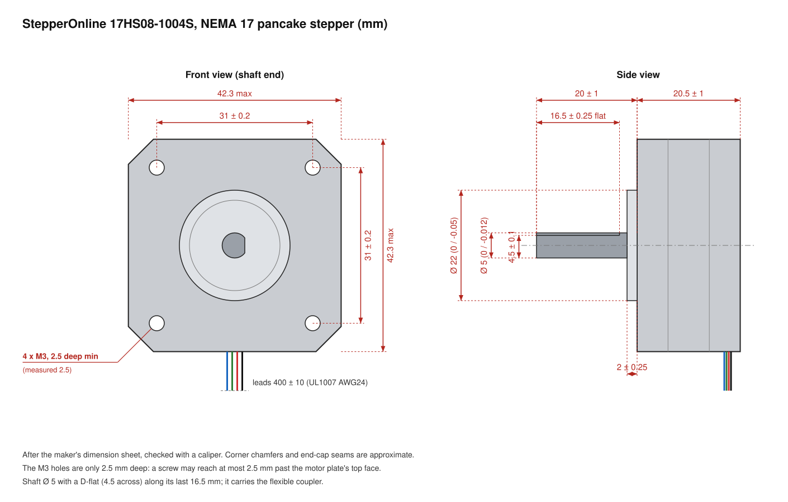
</p>

<p align="center">
  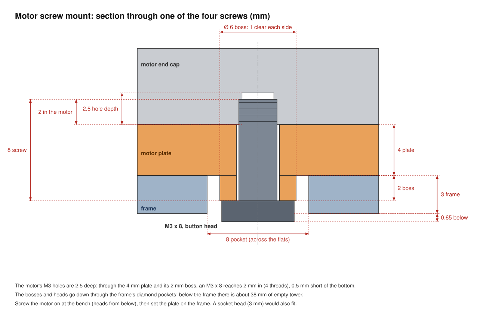
</p>

### The AS5600 board, a magnetic rotary position sensor

The kit board, measured. Its four mounting holes form a 16.7 × 16.2 mm rectangle (not a square); the diagonal slots in the encoder plate take it as well as the smaller 20 × 20 boards. Mount it chip up, under the magnet, and solder the wires straight into its holes: they run inward under the board, in the 2 mm the standoff pads leave, and down through the diamond window under the chip.

<p align="center">
  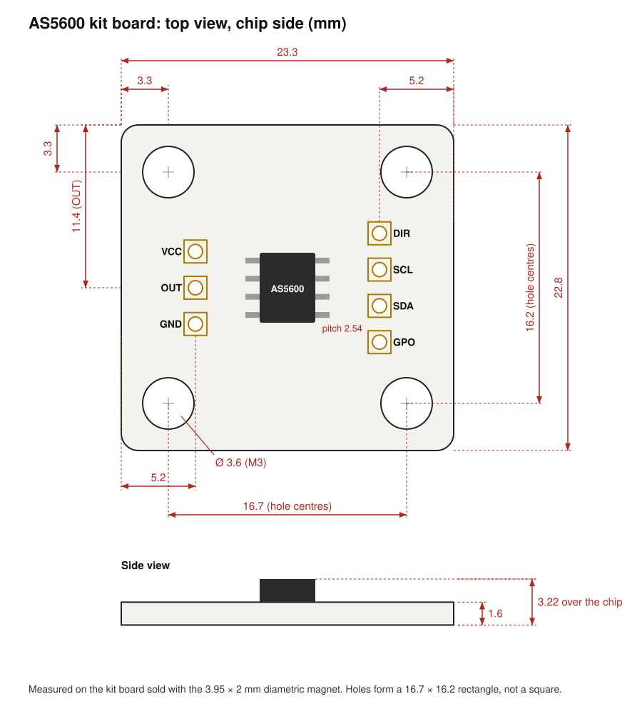
</p>

### The ESP32-S3 board, the Wi-Fi microcontroller

The Freenove ESP32-S3-WROOM Lite, measured. Its two pin rows are 25.3 mm apart, so they land 10 holes apart on the perfboard. It has two USB-C connectors at one end: plug the cable into the USB-UART one (power and console). The module's antenna sticks out 7 mm beyond the other end.

<p align="center">
  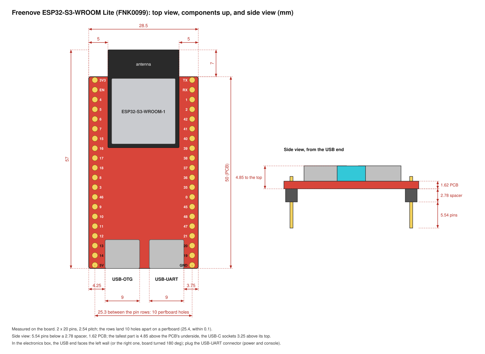
</p>

### The TMC2209 module, a silent stepper motor driver

A StepStick-format driver, measured: 20.81 × 15.08 mm, two rows of 8 pins 12.7 mm apart (5 holes on the perfboard). The chip is on the underside; its heatsink (15 × 14.4 mm, fins along the pin rows) sticks onto the thermal pad on top, toward the DIR/GND end so it clears the potentiometer, and stands 14.70 mm from the board's underside.

<p align="center">
  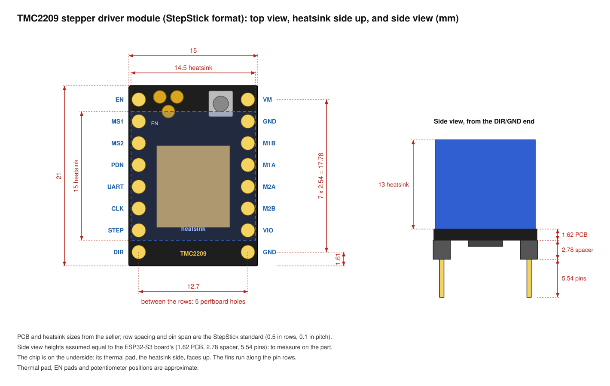
</p>

### The SCD40 board, the CO₂ sensor

The Sensirion SCD40 on a small 13.70 × 21.70 mm board, measured: 7.85 mm from its underside to the sensor's top, four pin holes 2.54 mm apart along the bottom edge (GND, VDD, SCL, SDA). It carries its own I²C pull-ups (R1, R2, 10 kΩ), so the controller needs none for it. On the controller PCB, J5 has the same pin order, so a straight 4-wire cable joins them. Keep the sensor's membrane uncovered (see the warning above).

<p align="center">
  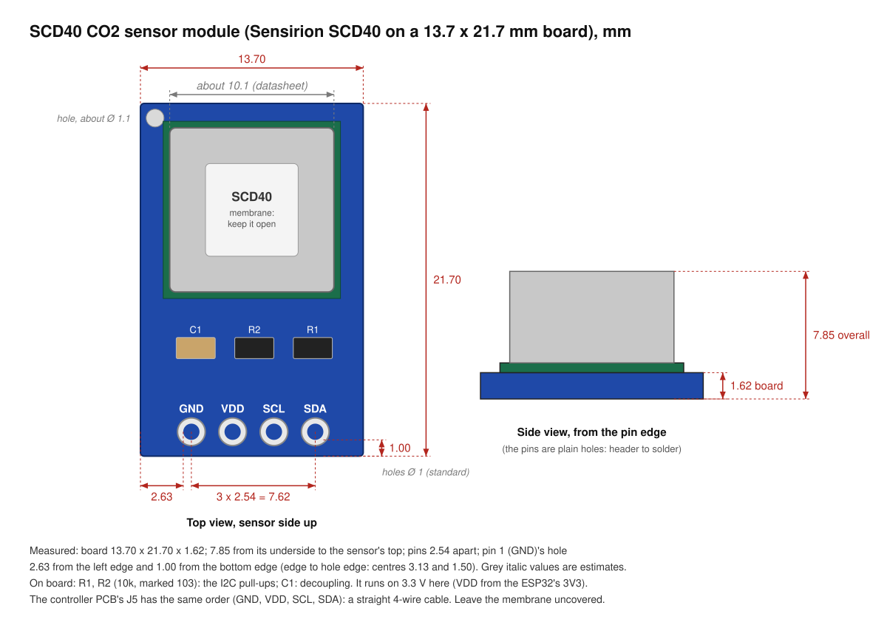
</p>

### The electronics box layout

The box seen from above, to scale, with the room at the bottom. The ESP32 lies across the back half, its pins soldered on the perfboard's grid, with its USB-end pins one column in from the board's edge so they clear the corner standoff; the TMC2209 sits at the front right, next to the 12 V terminal and the cable entry. The ESP32 can also be turned 180° in the same place, USB end toward the right wall: the box has a diamond opening on each side (views `ebox_elec` and `ebox_elec_alt` in the model). Keep wires and copper away from the antenna's end.

<p align="center">
  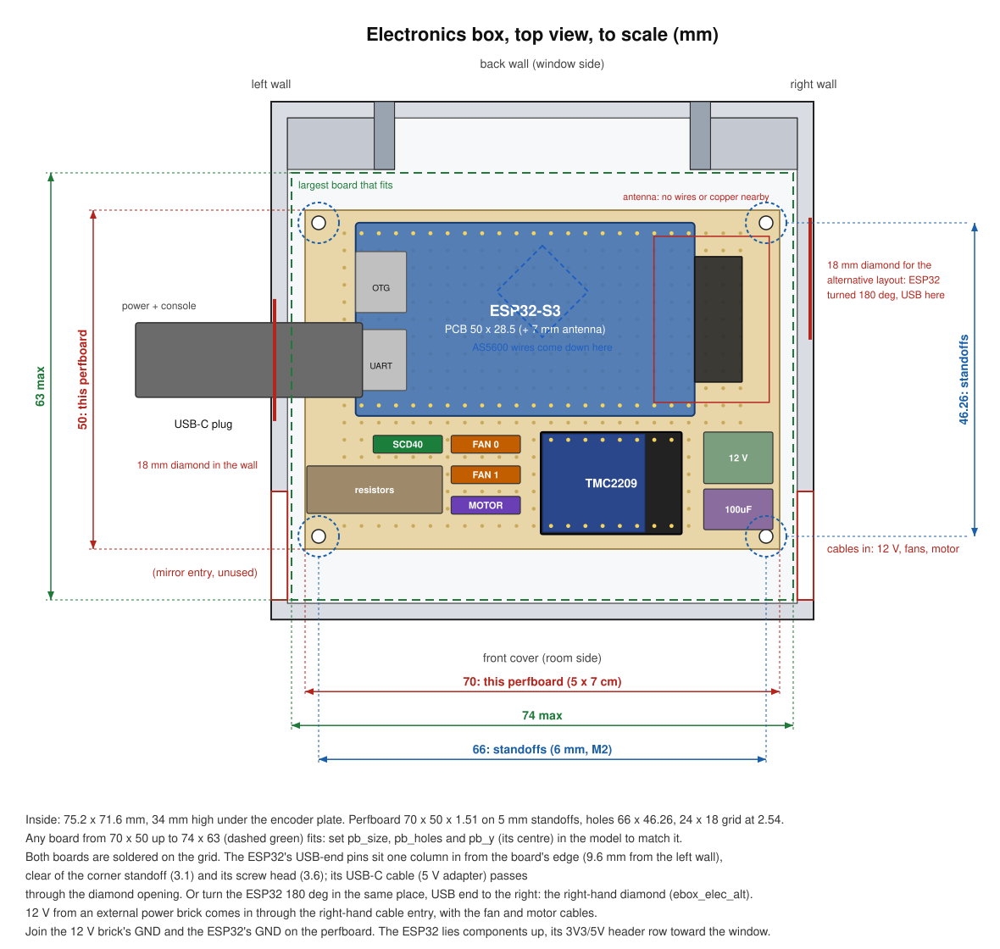
</p>

### Firmware

The ESP32 runs an Arduino sketch (esp32 core 3.x, no other library). The first stage, [`firmware/baremetal/`](firmware/baremetal), is a serial command console that tests each electronic part on its own: fans, motor and driver, encoder, CO₂ sensor, temperature probes and the 12 V supply. It compiles cleanly but has not run on hardware yet. The CO₂ control with its own web page on the home network comes next. [firmware/README.md](firmware/README.md) has the board settings, the [wiring diagram](firmware/images/wiring.svg), a part-by-part bring-up and the command list.

<p align="center">
  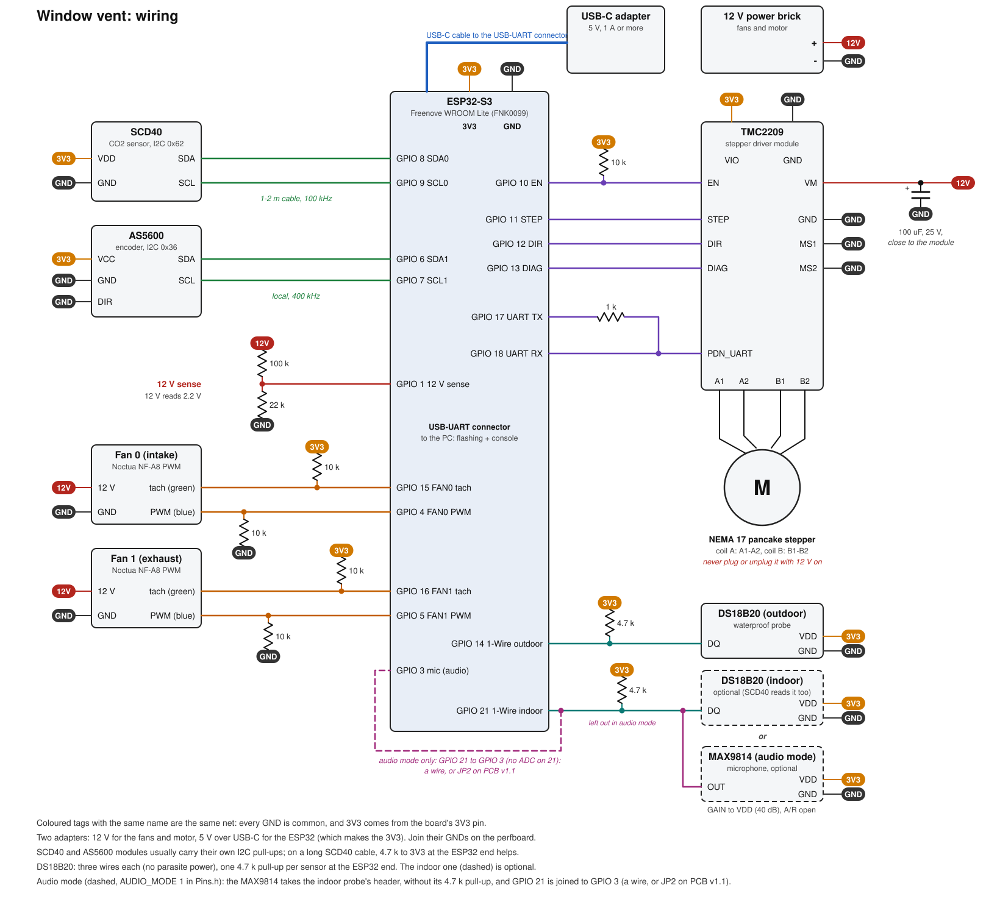
</p>

**Building the perfboard.** The [build plan](doc/perfboard.svg) puts this wiring on the 5 × 7 cm protoboard: the ESP32-S3 and the TMC2209 on their grid positions in the box, the headers, resistors, capacitor and 12 V terminal around them, and 61 numbered wires on the underside, each listed with both of its holes. A [PDF version](doc/perfboard.pdf) splits it over three landscape Letter pages for the bench: the component side, the solder side and the wire list. Solder the parts and the wires that run under the modules first, then the two modules.

<p align="center">
  <a href="doc/perfboard.svg">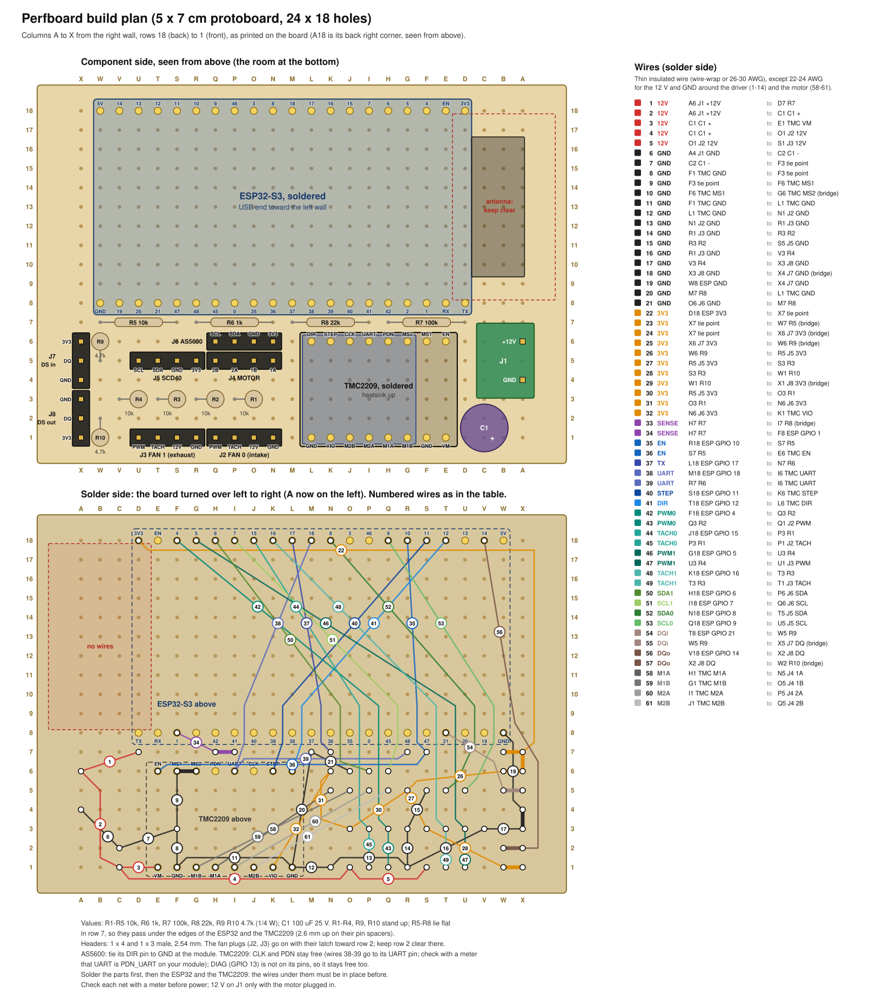</a>
</p>

**Or a printed circuit board.** The same circuit also exists as a 2-layer PCB of the protoboard's size (70 × 50 mm, 1.6 mm) with the same four M2 holes, so it drops into the box in its place: the ESP32-S3 and the TMC2209 sit on exactly the same pins, and every connector keeps its function. It adds a ground plane on both layers, 0.8 mm tracks for 12 V and the motor, a 1N5822 against a reversed 12 V plug (a jumper on JP1 bypasses it), and test pads for GND, 3V3, VIN, 12 V and the TMC2209's DIAG. Five boards cost US$10 to 32 at PCBWay with shipping, depending on its speed: upload [the Gerber zip](pcb/window_vent_ctrl_v1.0_gerbers.zip) and keep the standard options (2 layers, FR-4, 1.6 mm, 1 oz, HASL lead-free). [The schematic](pcb/window_vent_ctrl_schematic.pdf) and the KiCad 10 project are in [pcb/](pcb); the scripts `tools/pcb_*.py` build all of it, Freerouting doing the routing.

<p align="center">
  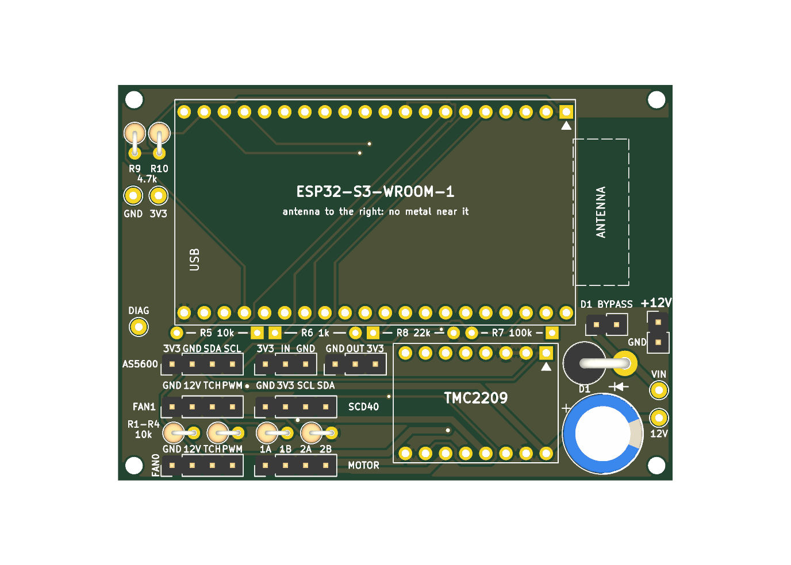
  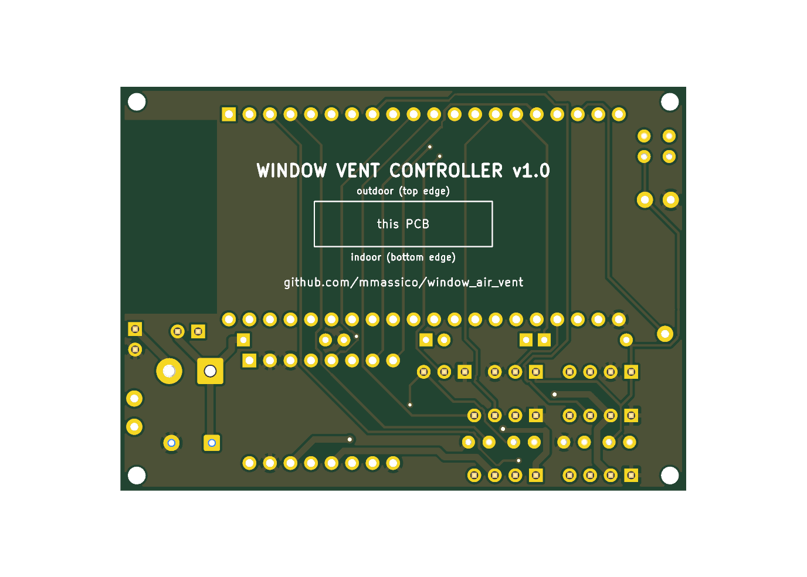
</p>

### The encoder magnet

The AS5600 measures the direction of the magnetic field across the shaft, so the magnet's north-south axis must lie **across** the shaft and turn with it.

- A **diametric** magnet (magnetized across its diameter) does this lying flat on the shaft end. AS5600 boards are usually sold with one: this kit's measures 3.95 × 2 mm, others 6 × 2.5 or 6 × 3 mm. This is the default (`magnet = "diametric"`, `magnet_d = 4`, `magnet_h = 2`); set them to the one you have.
- An ordinary small cylinder magnet is usually **axial** (poles on its flat ends). Lying flat it would not work, but lying on its side it does: set `magnet = "sideways"` for a cap that holds a 2 × 2 mm cylinder across the shaft. A magnet that small may be too weak at 1–2 mm; the AS5600's status register reports "too weak / OK / too strong", so check it once.
- Without any magnet, the TMC2209's StallGuard can find "closed" by sensing the stall against the lips.

### Cutting the lip foam

Full-size templates for the foam on the four lips (two per duct). The flat lip takes a half-ring; the conical lip takes the cone unrolled, a flatter arc that lies on the 45° slope without wrinkles. Print the [PDF](doc/lip_templates.pdf) at 100 % (Actual size, not Fit to page), check its 100 mm and 50 mm bars with a ruler, then trace the shapes on the foam's backing paper and cut.

<p align="center">
  <a href="doc/lip_templates.pdf">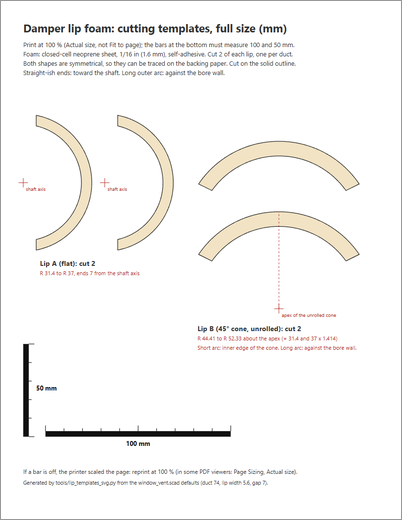</a>
</p>

If the 1.6 mm foam proves too stiff for the disc to close, setting `gasket = 1.6` moves the lips back to suit it (checked: the disc still swings freely and the lips still stop it).

### Drilling the foam insert

The insert takes two 83 mm holes, 96 mm apart, intake on top. The housing's plain Ø 83.7 spigots are a snug fit in them (the saw measures 83.3 across its teeth, so its holes come out about 83.3), so no O-rings are needed (sand a tight hole a little). Print the [drilling template](doc/foam_template.pdf) at 100 %, check its 100 mm bars, tape it on the foam centred across its width, and mark both centres with an awl. The template also marks an optional hole for the outdoor temperature probe, above the intake.

<p align="center">
  <a href="doc/foam_template.pdf">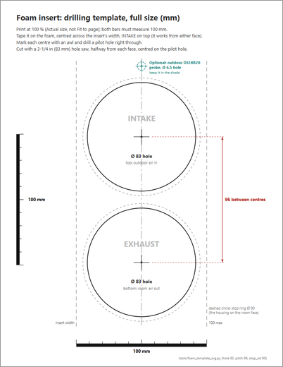</a>
</p>

**Straight pilot holes (optional).** A pilot hole that leans sends the hole saw off its line on the far face. The printed `drill_guide` keeps the bit perpendicular: two 20 mm bushings, A for the hole saw's pilot holes (1/4 in bit) and B for the probe's hole (6.5 mm), set in `guide_d` to suit your bits. Lay it on the taped template: the notches at both ends on the vertical centre line, and the side notches of the bushing you use on that hole's cross line. Hold it down and drill straight through the paper and the foam; then move it to the next hole. The bit has to reach through 20 mm of bushing and 51 mm of foam, so use one with at least 75 mm of flute (a 6 in aircraft bit, for instance). Run each bit through its bushing once before the first hole, to size the bore.

| Part | <div style="width:180px">Thumbnail</div> | Size (mm) | Time | Print orientation |
|---|:---:|---|---|---|
| `drill_guide` | 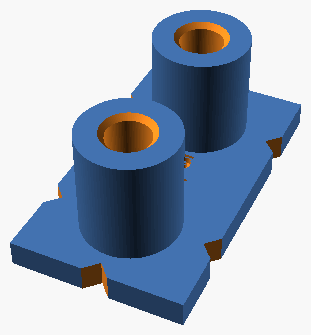 | 26 × 46 × 20 | about 20 min | Base on the bed, bushings up |

A 3-1/4 in (83 mm) bi-metal hole saw cuts only 32 mm deep, less than the 51 mm foam. Two ways to get through:

- **From both faces (easiest):** drill the pilot hole right through at each centre (a skewer or a long nail finds it on the far face if the pilot drill is too short), cut halfway from one face, turn the foam over and finish from the other. The two cuts meet with about 13 mm of overlap, and neither face tears out.
- **From one face:** cut 32 mm deep, carve the plug out (crossed cuts down to the groove, then pry the pieces out), and cut on: the pilot hole, already deeper, keeps the saw centred. Clamp a scrap board under the far face so the foam doesn't tear where the saw comes out.

Run the drill slowly. Hole saws often cut a little wider than labelled, so cut a test hole in a scrap first and try `oring_test` in it. A hot-wire foam cutter also works, and leaves the smoothest bore.

<p align="center">
  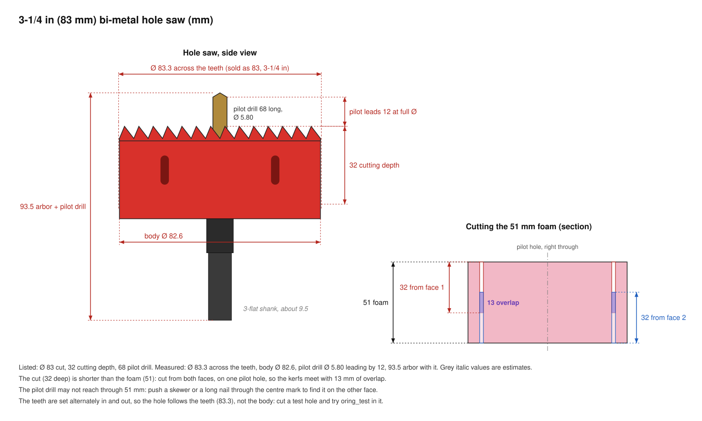
</p>

## Assembly

0. Split housing only: press four M3 nuts into the splice's pockets. Stand the lower half upright, cut face up, hold the splice against the back of its fan plate, just above the duct, and fit the two lower countersunk M3 × 12 from the fan side. Lower the upper half onto it and fit the other two. Leave all four slightly loose until step 3.
1. Line the lips inside the ducts with foam cut from the [templates](#cutting-the-lip-foam): a half-ring on each flat lip, an unrolled arc on each conical lip (B).
2. Slide each disc edge-on into its duct from the fan end, hub toward the room, with the half engraved B on the side of the conical lip (the right side, seen from the room).
3. Drill the fins out of the four shaft holes if not done yet (see [Printed parts](#printed-parts)). Push the shaft down through the frame on top, both ducts and both disc hubs. Split housing: the shaft now lines up the two halves; tighten the four splice screws.
4. Turn both discs closed against the lips and tighten their grub screws (two per disc) through the duct openings.
5. Screw the AS5600 board onto the four standoff pads, chip up, with its wires soldered into its holes and led inward under the board, then down through the diamond window under the chip. Glue the magnet into the cap and slide the cap onto the shaft's bottom end. Lay a 1 mm shim on the chip (a plastic card works), slide the cap down until the magnet rests on it, tighten the cap's grub screw, and remove the shim.
6. On the bench, screw the motor to the motor plate (4 × M3 × 8 from below) and fit the coupler on the motor shaft.
7. Lower the motor and plate onto the top of the housing, with the coupler through the big diamond and over the shaft end, and the plate's two back tabs down through the slots in the frame. In front of the motor, put an M3 × 10 down through the plate and the frame, with a nut underneath, reached from the tower's open front above the fan plate. At the back, put an M3 × 10 through each tower wall and its tab from outside, with a nut on the inside, reached from the tower's open back. Then tighten the coupler's lower screw through a side window.
8. Fit the fans: the top one blowing into the room, the bottom one blowing toward the window. Arrows engraved on both sides of the housing (above the upper duct and below the lower one) show each duct's airflow; match the arrows on the fan frames to them.
9. Electronics: solder the ESP32 and the TMC2209 onto the perfboard (or into female headers), following the [layout](#the-electronics-box-layout): the ESP32 across the back half with its USB-end pins one column in from the board's edge (clear of the corner standoff), the TMC2209 at the front right. Or turn the ESP32 180° in the same place, its USB end toward the right wall (view `ebox_elec_alt`): the box has a diamond on each side. Wire it (connect the 12 V brick's GND to the ESP32's GND), and screw it onto the four standoffs in the box (M2). Plug the USB-C cable in through the matching side wall. Bring the 12 V wire and the fan and motor cables down the right side, tie them to the three anchors behind the fans, and into the box through the notch at the top of its right wall. The AS5600 wires drop in through the window in the encoder plate.
10. Fit the box under the housing, its two back tabs up through the notches in the encoder plate: two M3 × 12 through the front cover into the bosses of the bottom bay, and at the back an M3 × 10 through each bay wall and its tab from outside, with a nut on the inside, reached from the bay's open back.
11. Push the housing's spigots into the foam holes. If they're tight, sand the holes a little. (With `orings = true`, roll two O-rings onto each spigot first.)

## Optional: adjustable louvers for the intake fan

In winter the incoming air is cold, and a jet straight off the fan can feel like a draft. These louvers clip onto the room face of the intake fan and aim the air: upward along the ceiling, for example, so it mixes with the room air before it reaches anyone.

<p align="center">
  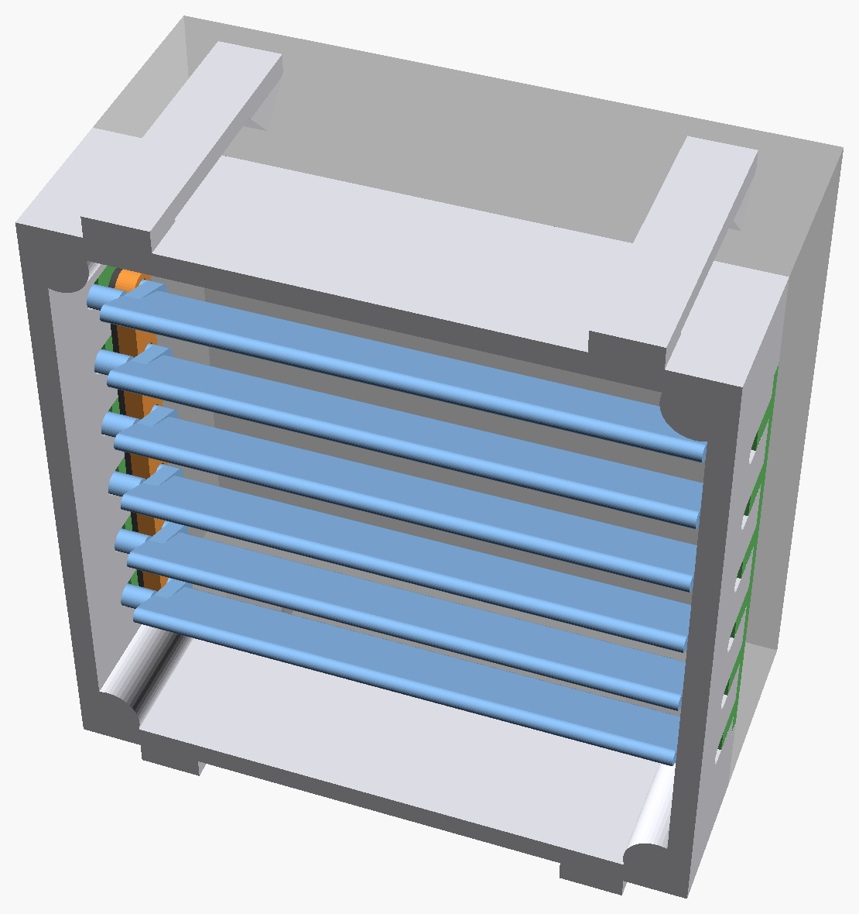
</p>

- **Clips, no screws.** Four hooks reach back over the fan's corner flanges and catch behind them. Recesses in the frame's corners fit over the fan's screw heads, so the fan keeps its normal screws. A firm pull takes the louvers off.
- **The blades turn together.** Each of the six blades pivots on pins in U-slots in the side walls. On one side, a link bar joins an offset pin on every blade, so turning any blade turns them all, from −45° to +45°. The link runs along the room side of the blades, and a ribbed tab in its middle sticks out of the frame at every angle: push it up or down to set the angle. (Set `link_side = "back"` to hide the link between the blades and the fan instead, without the tab.)
- **They hold their angle.** The pins fit snugly in their slots, and a strip of felt or foam tape on the link bar rubs on the side wall. The strip also damps vibration. On the other side, a collar on each blade's pivot bears on the wall.
- **Nothing falls out.** The slots open toward the fan, so the blades drop in from behind. A retaining comb in each side wall then plugs the slots behind the pins; a snap arm at each end of the comb clicks it in place, and once the frame is on the fan, the fan's face holds the combs in too.

| Part | <div style="width:180px">Thumbnail</div> | Qty | Description | Size (mm) | Print orientation |
|---|:---:|---|---|---|---|
| `louver_chassis` | 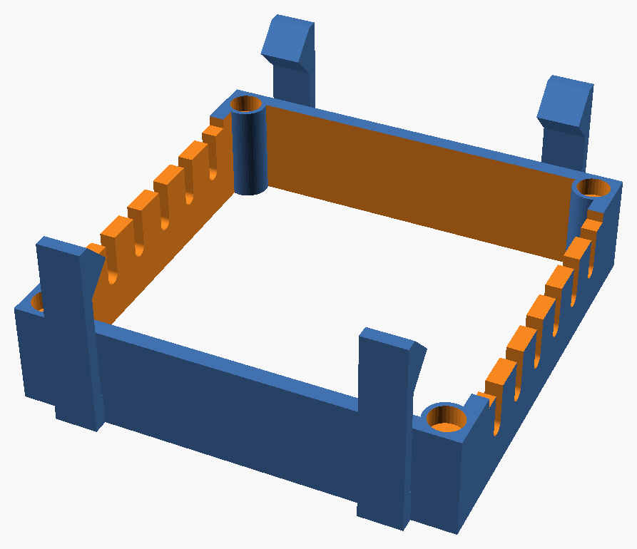 | 1 | Frame: clips onto the fan's corner flanges (recesses clear its screw heads), U-slots for the blade pins in both side walls | 80 × 86 × 36 | Front face on the bed, clips up |
| `louver_blade` | 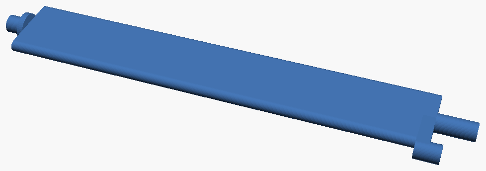 | 6 | Blade with a pivot pin at each end, a collar on one side and an offset pin for the link on the other | 79 × 14 × 3.5 | Flat; its pins are flattened on the bed side |
| `louver_link` | 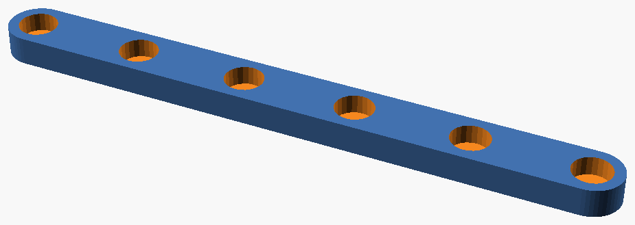 | 1 | Link bar joining the six offset pins, so the blades turn together, with the tab that sets the angle; the felt strip goes on its flat face | 53 × 11 × 2.8 | Flat, holes and ribs up |
| `louver_retainer` | 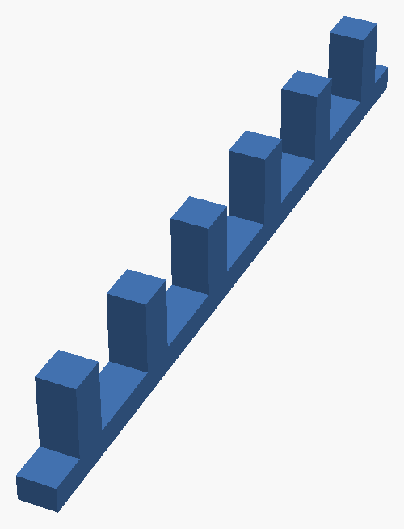 | 2 | Retaining comb, one per side wall: plugs the slots behind the pins, with a snap arm at each end | 3 × 57 × 11 | Spine down, pegs up |

About 34 cm³ (45 g) of PETG in all. Also needed: a strip of 1 mm felt or foam tape, about 5 × 52 mm, for the link bar.

**Assembly:**
1. Stick the felt strip on the link bar's flat face (the face without holes).
2. Push the link onto the six blades' offset pins.
3. Slide the blades into the U-slots from the back of the frame, their offset pins toward the room (the link at the front, its tab pointing out of the frame): the link and its strip go on the side with the link pins, the collars on the other.
4. Press a retaining comb into the back of each side wall, the small round ridge under each peg down, into the groove in the slot's floor (it keeps the pegs centred in the wall), until both snap arms click. A firm pull takes it out again.
5. Clip the frame onto the intake fan.

**Tuning after a test print**, in `cad/louvers.scad`:
- **`slot_w`:** the grip of the pins in their slots. Lower makes the blades stiffer.
- **`clip_lip`, `clip_edge` and `clip_w`:** the clips. They're sized for the Noctua NF-A8 (a 7 mm corner flange, with the clips 8 mm in from the side edges so they clear the corner screws).
- **`pad_t` and `pad_sq`:** the friction strip and how much it's squeezed.
- **`comb_fit`, `comb_key`, `key_shape`, `key_clr` and `snap_l`, `snap_t`, `snap_b`:** the combs' pegs in their slots, the guide ridge under each peg in its groove (half-round by default, or a V), and the snap arms. Print `peg_test2` first (about 25 min): a three-slot slice of the side wall, cut from the chassis itself, with a three-peg comb and its snap arms.


## Files

```
doc/                        reference drawings: the motor, the AS5600, ESP32-S3, TMC2209 and SCD40 
                            boards, the electronics box layout, the perfboard build plan (and PDF); 
                            the lip foam and foam insert templates (PDF, to print at 100 %), the 
                            hole saw
images/                     renders used in this README
cad/window_vent.scad        parametric model (Customizer; part = "assembly" for the preview)
cad/louvers.scad            optional adjustable louvers for the intake fan
stl/                        exported parts (default parameters)
pcb/                        the controller PCB (KiCad 10): schematic and its PDF, board, Gerber zip 
                            for ordering, renders
tools/check.py              geometry checks (must print ALL CHECKS PASSED); vent or louvers: just one
tools/wiring_svg.py         draws firmware/images/wiring.svg (the wiring diagram)
tools/as5600_svg.py         draws doc/as5600.svg (the AS5600 board, dimensioned)
tools/ebox_layout_svg.py    draws doc/ebox_layout.svg (the electronics box, to scale)
tools/esp32_svg.py          draws doc/esp32_s3.svg (the ESP32-S3 board, dimensioned)
tools/tmc2209_svg.py        draws doc/tmc2209.svg (the TMC2209 module, dimensioned)
tools/scd40_svg.py          draws doc/scd40.svg (the SCD40 CO2 sensor board, dimensioned)
tools/motor_svg.py          draws doc/motor_17hs08.svg (the stepper motor, dimensioned)
tools/motor_mount_svg.py    draws doc/motor_mount.svg (section through a motor screw)
tools/lip_templates_svg.py  draws doc/lip_templates.svg and .pdf (full-size foam templates) and 
                            their preview
tools/foam_template_svg.py  draws doc/foam_template.svg and .pdf (drilling template for the foam 
                            insert) and its preview
tools/holesaw_svg.py        draws doc/holesaw_83.svg (the 83 mm hole saw, and cutting the foam 
                            from both faces)
tools/perfboard_svg.py      draws doc/perfboard.svg and .pdf (the perfboard build plan: both sides 
                            and the wire list)
tools/pcb_*.py              build pcb/ with KiCad 10 and Freerouting: parts and nets (pcb_parts.py), 
                            schematic, layout, routing, then labels and Gerbers (pcb_finish.py)
tools/render_images.py      regenerates the images in images/ from the models
firmware/baremetal/         Arduino sketch: serial commands to test each electronic part (not 
                            tested on hardware yet; see firmware/README.md)
PRINT_CHECKLIST.md          every printed/bought part interface to verify before printing
```

## License

Copyright (c) 2026 Marc-Antoine Massicotte.

This design (CAD model, STL files, images, documentation and scripts) is released under the [CERN Open Hardware Licence Version 2 - Permissive](LICENSE) (CERN-OHL-P-2.0). You may use, modify, make, share and sell it freely, as long as you keep this notice. It comes with no warranty of any kind, and the author accepts no liability for its use.

The firmware in [`firmware/`](firmware) is software, so it is released under the [MIT License](firmware/LICENSE) instead: same idea, free to use, modify and share, keep the notice, no warranty.
