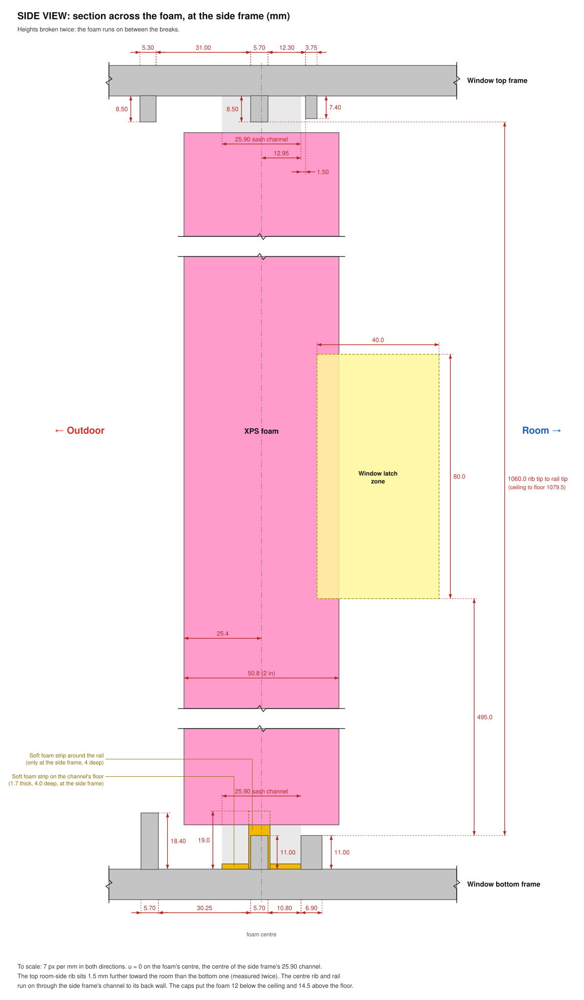

# Window insert

The foam insert that fills the window gap under the [window vent](../README.md), and the printed caps on its four edges that fit it to the window's profiles. The foam itself stays a plain rectangle: the caps carry every rib, rail and groove of the frame and the sash, so no complex shape is ever cut in foam.

It is measured on one horizontal sliding window: the sash opens about 10 cm, and the insert fills that gap from the floor of the track to its ceiling. Another window needs its own measurements, but the same approach.

> **Status: fit tests.** The four profile slices are printed and fit the window, after one correction: the top frame's room-side rib sits 1.5 mm further toward the room than the bottom one. The corner test pieces are printed but not tested yet. The full-length caps come next; the side cap will need a relief at the window latch.

## How it works

- **The foam:** 2 in XPS (50.8 mm), 100 mm wide, about 1050 mm tall (the opening's 1079.5 mm, less the top and bottom caps, less 2 or 3 mm for foam tape in the top channel).
- **Top and bottom caps:** one piece each, 106 mm long, from the side frame's face to the sash's end. Slots in them fit over the top frame's ribs and the bottom track's rails.
- **Side cap:** runs the full height. Its tongue goes into the side frame's sash channel from the floor to the ceiling, notched for the centre rib and rail (they run through the channel to its back wall) and for a soft foam strip at the back of the channel, around the rail's end.
- **Sash cap:** runs the full height too. It is a channel that takes the sash's end the way the side frame does, with a tongue in the sash's end groove.
- **Lips:** every cap has a lip on each face of the foam, 10 mm deep and 2.4 mm thick. They keep the foam from falling indoor or outdoor. The top and bottom caps' lips run their full length and straddle the ends of the side and sash caps, which aligns the corners.
- **Gaps:** 0.5 mm where a cap's end meets another cap, for foam tape. 0.3 mm per side on the window's ribs and channels, 0.5 mm at the bottom of a slot.

The side and sash caps are about 1053 mm long, so they will print in segments of about 215 mm, joined by sleeves with a snap tab. The caps print in one piece across their section, with low infill: the trapped air insulates, and only thin walls bridge the cold and warm faces.

## Installation

Like a drawer. Nothing is glued, so it all comes out again in spring.

1. Open the sash wider than usual, about 20 to 25 cm.
2. Push the side cap into the side frame's channel.
3. Set the bottom cap on its rails, a little away from the side frame, and slide it along them against the side cap. Do the same with the top cap on its ribs, holding it up.
4. Slide the foam in sideways, between the top and bottom caps' lips, until its edge seats in the side cap. It now holds the top cap up.
5. Put the sash cap on the foam's other edge.
6. Close the sash against it: it clamps everything across the window.
7. Tape over the joint between the lips and the foam on the room side, for drafts.

The sash can't reach its latch with the insert in, so a stop behind it in its track is worth adding: it keeps the sash from being slid open, and keeps the insert clamped.

## The window's measurements

All in mm. u runs across the foam's thickness from its centre, the centre of the side frame's 25.90 sash channel. Both drawings are to scale; the side view breaks the foam's height twice.

<p align="center">
  
</p>

<p align="center">
  
</p>

- **Latch zone:** the window latch on the side frame needs 40 mm across, 80 mm of height and 40 mm into the opening, starting at u = 18.20, 495 mm above the rail tips. The foam gets a notch there (37 × 7.2 × 80 mm), and the side cap's room-side lip and base stop around it. The air seal (tongue and outdoor lip) runs past it unbroken.
- **Soft foam strip:** at the back of the side frame's channel, around the centre rail's end: 7.0 wide, 19.0 high, 4.0 deep. The side cap's tongue is notched to clear it.

## Test prints

Fit the profiles first, then the corners. Print in PETG: PLA turns brittle in the cold.

| Part | Size (mm) | What it checks |
|---|---|---|
| `slices` (or `slice_top`, `slice_bottom`, `slice_side`, `slice_sash`) | four slices 5 thick, on one plate about 110 × 100 | Each cap's cross-section against the window. The tab at the end of each slice is exactly as wide as the foam, an engraved line marks where the foam starts, and "OUT" marks the outdoor half. A cross-lap slot in each tab keys a top or bottom slice to a side or sash slice in a corner: if the pair won't sit in the corner, the two profiles disagree on the foam's position |
| `corners` (or `corner_top`, `corner_bottom`, `corner_side_top`, `corner_side_bottom`, `corner_sash_top`, `corner_sash_bottom`) | six pieces, 40 to 55 tall | The real cap ends where they meet. One top and one bottom piece serve both corners: turn them end for end for the sash's corners. Print two of each to try all four corners at once |

Everything prints standing, its cross-section on the bed, with no supports. The STLs in [`stl/`](stl) are exported in that orientation, with the default parameters.

## Files

```
cad/window_caps.scad          parametric model of the caps and their test pieces (Customizer;
                              part = "corners_view" with a small H, such as 160, for the preview)
stl/                          the test pieces, exported (default parameters)
doc/window_top_view.svg       the window's profiles at mid-height, seen from above, to scale
doc/window_side_view.svg      the window's profiles across the foam, at the side frame, to scale
tools/window_profiles_svg.py  draws both drawings from the measurements in it (the same values as
                              in cad/window_caps.scad)
```

To export a part from the command line:

```
openscad -o stl/corners.stl -D 'part="corners"' cad/window_caps.scad
```

## License

Part of the window vent: released under the same [CERN Open Hardware Licence Version 2 - Permissive](../LICENSE) (CERN-OHL-P-2.0).
