# Window insert

The foam insert that fills the window gap under the [window vent](../README.md), and the printed caps on its four edges that fit it to the window's profiles. The foam itself stays a plain rectangle: the caps carry every rib, rail and groove of the frame and the sash, so no complex shape is ever cut in foam.

It is measured on one horizontal sliding window: the sash opens about 12 cm, and the insert fills that gap from the floor of the track to its ceiling. Another window needs its own measurements, but the same approach.

<p align="center">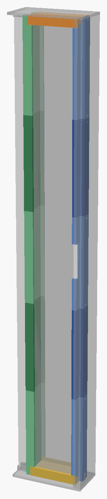</p>

The insert in the window, seen from the room, with the window and the foam drawn transparent. On the right:

1. Top corner at the side frame, from below: the top cap's slots over the ribs, and the side cap's tongue notched for the centre rib.
2. Bottom corner at the side frame: the tongue's legs straddle the centre rail and the soft foam strip.
3. Bottom corner at the sash: the sash cap's walls run down to the floor beside the sash.

Side cap in blue, sash cap in green, top cap in orange, bottom cap in yellow. The side and sash caps' pieces alternate between a light and a dark shade. In OpenSCAD: `part = "assembly_view"`, and `explode = 50` to spread the pieces apart.

> **Status: in use.** The vent runs in the window in this foam insert, and the outdoor microphone's tube is printed and installed through it. The profile slices, the corner pieces, a joint and the latch slice are printed and fit the window, after a few corrections: the top frame's room-side rib sits 1.5 mm further toward the room than the bottom one, the sash's groove has screw heads near its ends, and a soft strip lies on the side frame channel's floor. The full caps are exported for the measured foam.

## How it works

- **The foam:** 2 in XPS (50.8 mm), 112 mm wide, about 1050 mm tall (the opening's 1079.5 mm, less the top and bottom caps, less 2 or 3 mm for foam tape in the top channel).
- **Top and bottom caps:** one piece each, 118 mm long, from the side frame's face to the sash's end. Slots in them fit over the top frame's ribs and the bottom track's rails.
- **Side cap:** runs the full height. Its tongue goes into the side frame's sash channel from the floor to the ceiling, notched for the centre rib and rail (they run through the channel to its back wall) and for a soft foam strip at the back of the channel, around the rail's end. It stops 3.0 mm above the channel's floor, over another foam strip.
- **Sash cap:** runs the full height too. It is a channel that takes the sash's end the way the side frame does, with a tongue in the sash's end groove, made shallower near its ends over the screw heads in the groove. Past the sash's end face, the channel's walls go on to the ceiling and the floor, the room-side one notched for the top frame's room-side rib and the bottom track's room-side rail.
- **Lips:** every cap has a lip on each face of the foam, 8 mm deep and 4.8 mm thick. They keep the foam from falling indoor or outdoor, and leave 96 mm of foam uncovered across the window, so the vent's chassis (at least 90 mm wide) fits between them with 3 mm to spare on each side. For security, the sash stays open only 118 mm, close to the 100 mm opening that building codes commonly use as a limit, and the thick lips make the insert sturdier. The top and bottom caps' lips run their full length and straddle the ends of the side and sash caps, which aligns the corners.
- **Gaps:** 0.5 mm where a cap's end meets another cap, for foam tape. 0.3 mm per side on the window's ribs and channels, 0.5 mm at the bottom of a slot.

The side and sash caps run nearly the full height, so they print in pieces about 108 mm tall: five segments joined at 216, 432, 648 and 864 mm above the floor, each in two halves, a and b, joined at its middle (108, 324, 540, 756 and 972 mm). Whole segments, 215 mm tall, were knocked off the bed near their top as they printed standing; `halves = false` still exports them, and they fit the halves. Each piece has a socket in each end that meets another one: in the tongue for the side cap, in each wall for the sash cap. A separate joiner, printed flat, fills the two sockets of a joint. A bump near each of its ends clicks into a window in a tab of the socket's wall (two slits make the tab), so the pieces snap together without glue. The window and the bump are diamonds: their 45° edges print standing without an overhang, and a pull on the joint wedges the bump's V into the window's V, which centres it rather than pushing the tab out. Each socket's closed end is a 45° gable for the same reason, so a socket printed opening down needs no bridge. A socket printed opening up has a flat bottom instead, at the same depth: a firmer stop for the joiner. The side cap's tabs are on the tongue's back face, hidden in the channel; the sash cap's are on the walls' free ends. There the tab takes nearly all of the socket's outer wall, which would let the joint rock in the tab's direction, so the sash cap's sockets go 25 mm deep instead of 15: its joiners reach well past the tabs, into rigid walls.

The caps print in one piece across their section, with low infill: the trapped air insulates, and only thin walls bridge the cold and warm faces.

## Installation

Like a drawer. Nothing is glued, so it all comes out again in spring.

1. Open the sash wider than usual, about 20 to 25 cm.
2. Snap the side cap's pieces together on a table, then push the whole cap into the side frame's channel.
3. Set the bottom cap on its rails, a little away from the side frame, and slide it along them against the side cap. Do the same with the top cap on its ribs, holding it up.
4. Slide the foam in sideways, between the top and bottom caps' lips, until its edge seats in the side cap. It now holds the top cap up.
5. Put the sash cap, its pieces snapped together, on the foam's other edge.
6. Close the sash against it: it clamps everything across the window.
7. Tape over the joint between the lips and the foam on the room side, for drafts.

The sash can't reach its latch with the insert in, so a stop behind it in its track is worth adding: it keeps the sash from being slid open, and keeps the insert clamped.

## The window's measurements

All dimensions are in mm. Positions across the foam's thickness, called *u* in the drawings and the model, are measured from the foam's centre, which is also the centre of the side frame's 25.90 sash channel. Outdoor positions are negative. The drawings are to scale; the side view breaks the foam's height twice.

<p align="center">
  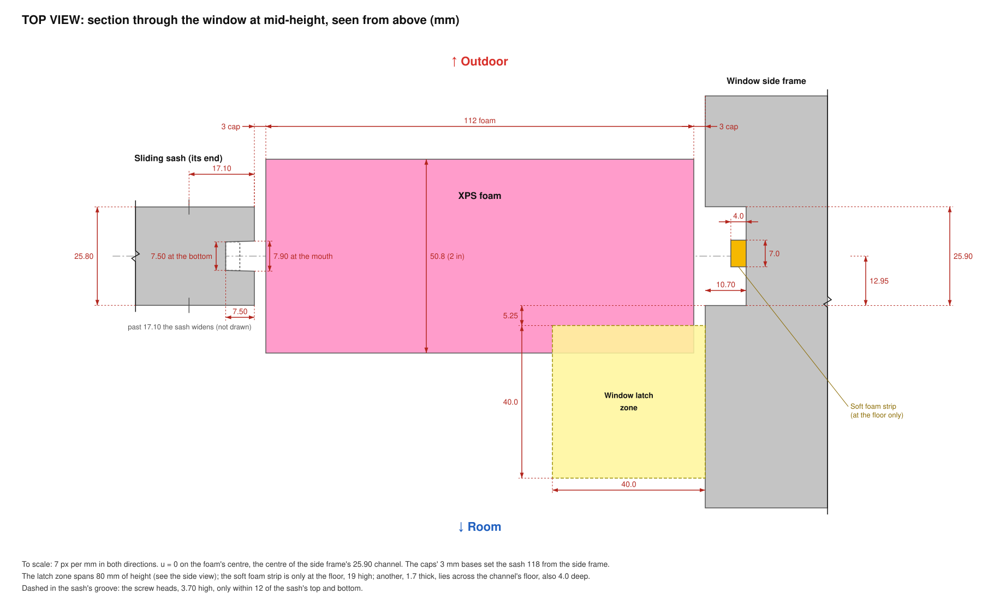
</p>

<p align="center">
  
</p>

<p align="center">
  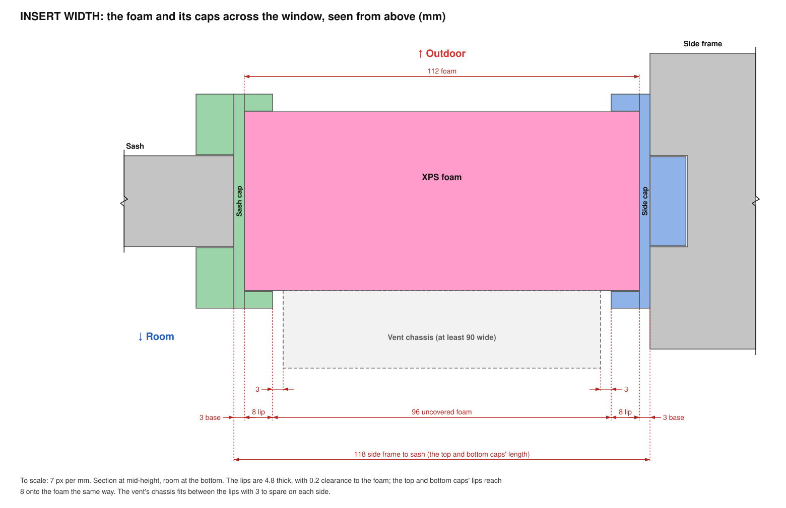
</p>

- **Latch zone:** the window latch on the side frame needs 40 mm across, 80 mm of height and 40 mm into the opening, starting at u = 18.20, 495 mm above the rail tips. The foam gets a notch there (37 × 7.2 × 80 mm), and the side cap's room-side lip and base stop around it. The air seal (tongue and outdoor lip) runs past it unbroken.
- **Soft foam strips:** at the back of the side frame's channel, around the centre rail's end: 7.0 wide, 19.0 high, 4.0 deep. The side cap's tongue is notched to clear it. Another strip lies across the channel's floor, also 4.0 deep from the back wall, 1.7 thick: the tongue stops 3.0 mm above the floor, 1.3 mm over it.
- **Screw heads:** in the sash's groove, near its top and bottom ends, standing 3.70 above the groove's bottom. The groove tongue is cut down to 3.3 deep over its last 12 mm at each end.

## Parts

### To print

Print in PETG: PLA turns brittle in the cold. Nothing needs supports, and the STLs in [`stl/`](stl) are exported in their print orientation, with the default parameters (see [Slicer settings](#slicer-settings)).

The caps are exported for 2 in foam (50.8 mm). The boards measured 49.9 to 51 mm, and the lips leave 51.2 mm, so the foam slides in. Each cap has its label engraved on its back (the face against the window, on its outdoor half): F for the side frame's cap, W for the window sash's. The pieces' labels read upward as installed.

| Part | <div style="width:180px">Thumbnail</div> | Label | Qty | Description | Size (mm) | Print orientation |
|---|:---:|---|---|---|---|---|
| `cap_top` | 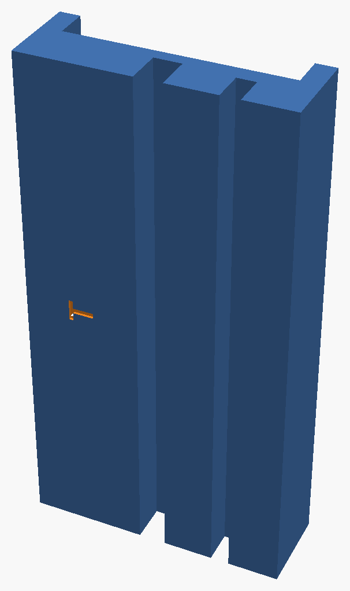 | T | 1 | Top cap, whole | 60.8 × 20 × 118 | Standing on its end |
| `cap_bottom` | 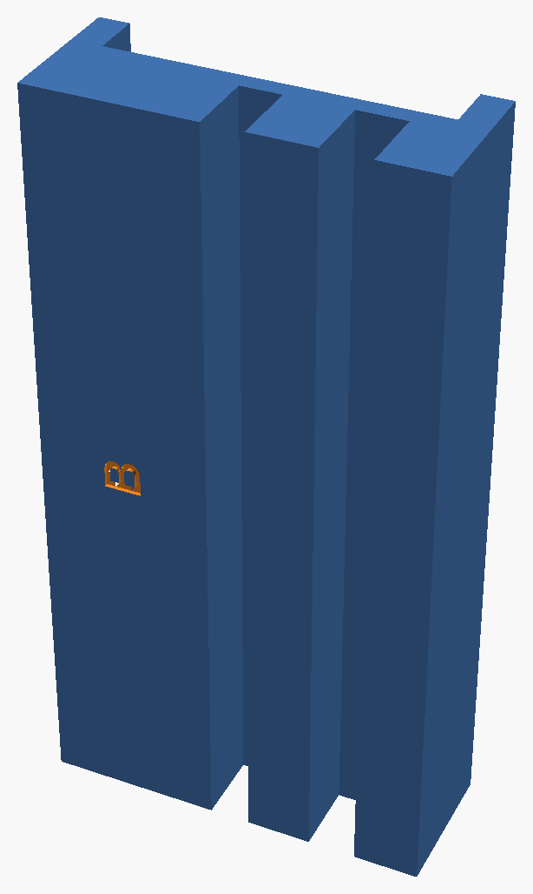 | B | 1 | Bottom cap, whole | 60.8 × 22.5 × 118 | Standing on its end |
| `side_0a` to `side_4b` |  | F0a to F4b | 1 each | Side cap's pieces, from `side_0a` at the floor: `side_0a`, `side_0b`, `side_1a` and so on. `side_2a` and `side_2b` have the relief around the window latch. Shown: `side_0a`, turned over | 21.2 × 60.8 × 105 to 108 | Standing; `side_0a` and `side_2b` turned over, on their upper end |
| `sash_0a` to `sash_4b` |  | W0a to W4b | 1 each | Sash cap's pieces, from `sash_0a` at the floor. Shown: `sash_0a`, turned over | 21.7 × 60.8 × 107 to 108 | Standing; `sash_0a` turned over, on its upper end |
| `joiners` | 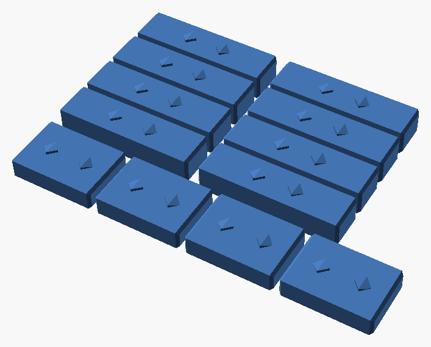 | | 1 plate | All the joiners: 9 for the side cap, 18 for the sash cap | 168 × 146 plate | Flat, bumps up |
| `latch_cover` | 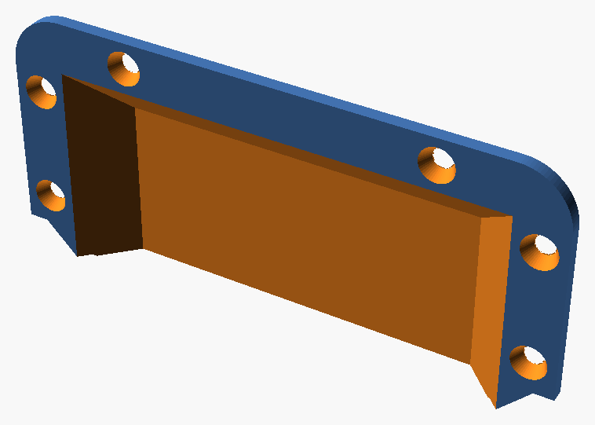 | | 1 | Liner for the foam's notch at the window latch, behind the latch: a flat floor 0.3 mm outdoor of the latch zone, 45° risers out to the foam's room face (they carry the side cap's relief on across the foam), and a 3 mm border on that face, screwed into the foam (6 countersunk holes). Its end against the side cap is open and straight; the cap's lip is notched out of the border's corners there, 0.3 mm clear. Its two corners toward the sash are rounded | 59 × 12.5 × 125 | Standing on its open end (the side cap's) |

**Plates.** Slicer estimates (Bambu Studio, the settings below), not measured prints:

- The two caps and the ten whole segments, on one plate, came to about 22 h 40 and 924 g of PETG; the halves weigh about the same as the segments (about 820 g for all twenty).
- The twenty halves, with the 20 mm brim and 15 mm between parts, need two plates.
- `side_2b` prints turned over, on its 648 mm end: its lower end is in the latch relief, which would leave it standing on a smaller face. The relief's slopes are 45° both ways, so it needs no supports.
- The joiners print on their own plate, with 4 walls and 40 % infill.
- `latch_cover` stands on its open end, a thin U on the bed: give it the 20 mm brim. The riser at its sash end is a 45° overhang; where the border starts past the cap's lip, a 3 mm wide ledge about 7 mm long bridges.

### Latch cover notch

The latch cover lines a notch in the foam's room face, at the side frame's end. Carve it to the cover's outside, 45° on its three sides:

- **Depth:** 9.5 mm from the room face.
- **On the room face:** from the foam's end to 47.6 mm along it, and from 480.9 to 582.1 mm above the foam's bottom edge (101.3 mm tall).
- **At the bottom:** to 38.1 mm from the foam's end, from 490.4 to 572.6 mm (82.3 mm tall).

A full-size [template](doc/latch_template.pdf) has both rectangles: print it twice at 100 % (check its 100 mm bars), cut one copy to the outer rectangle and trace it on the room face, its left edge on the foam's end, and cut the other to the inner one, to check the floor. Line them up in height with the notch in the assembled side cap. Carve a little small, then sand until the cover sits flush.

<p align="center">
  <a href="doc/latch_template.pdf">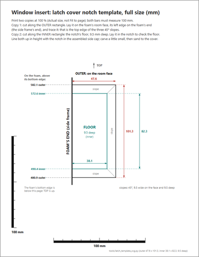</a>
</p>

Try the cover in the notch, then screw it on.

### To buy

| Item | Qty | Use |
|---|---|---|
| XPS foam board, 2 in (51 mm), 30 psi | 1 strip, 112 × about 1050 mm | The insert itself. A 24 × 48 in board is enough: cut the strip along its 48 in side. Notch it at the latch for the [latch cover](#latch-cover-notch), or 37 × 7.2 × 80 mm without it (see [the latch zone](#the-windows-measurements)). The [main parts list](../README.md#hardware) has the grade and why |
| Thin foam tape (weatherstrip) | About 1 m | In the top frame's channel (2 or 3 mm), and in the 0.5 mm gaps where the caps' ends meet |
| Tape that peels off cleanly | About 2.5 m | Over the joint between the lips and the foam on the room side, for drafts |
| Short screws, countersunk, 8 mm head | 6 | The latch cover, into the foam: 4.25 mm hole, a head 3.5 mm tall. The countersinks are 8.8 mm wide at the border's face (`lc_csk`), so the head sits just below it, and its tip goes on past the 3 mm border into the foam. Coarse threads hold best in XPS |
| PETG filament | About 1 kg | The caps (924 g), the joiners (25 g) and the latch cover (23 g) |

### Test pieces

Optional now: they checked the model against the window before the full caps. Print them in this order: the profiles, then the corners, then the latch slice and a joint.

**Profile slices.** Each slice is a cap's cross-section, 5 mm thick. The tab at its end is exactly as wide as the foam: its edges show where the foam's faces are, an engraved line marks where the foam starts, and "OUT" marks the outdoor half. A cross-lap slot in each tab keys a top or bottom slice to a side or sash slice in a corner (slide them together until both slots bottom out): if the pair won't sit in the corner, the two profiles disagree on the foam's position. `slices` puts all four on one plate, about 110 × 93.

| Part | <div style="width:180px">Thumbnail</div> | Qty | Description | Size (mm) | Print orientation |
|---|:---:|---|---|---|---|
| `slice_top` |  | 1 | Top cap's profile: slots for the top frame's centre rib and room-side rib | 50.8 × 31.6 × 5 | Flat, engraved face up |
| `slice_bottom` |  | 1 | Bottom cap's profile: slots for the bottom track's centre rail and room-side rail | 50.8 × 31.6 × 5 | Flat, engraved face up |
| `slice_side` | 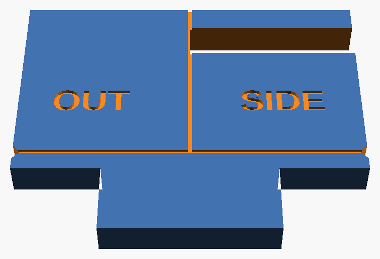 | 1 | Side cap's profile: the tongue into the side frame's sash channel | 50.8 × 41.8 × 5 | Flat, engraved face up |
| `slice_sash` | 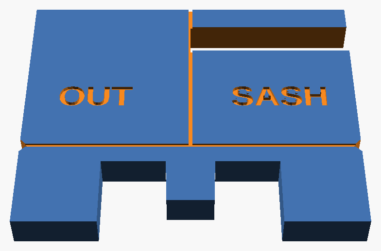 | 1 | Sash cap's profile: the channel that takes the sash's end, with the tongue in its groove | 50.8 × 42.3 × 5 | Flat, engraved face up |

**Corner pieces.** The real cap ends, 40 mm past the cap they butt against, to try in the four corners. `corners` puts all six on one plate, about 151 × 131.

| Part | <div style="width:180px">Thumbnail</div> | Qty | Description | Size (mm) | Print orientation |
|---|:---:|---|---|---|---|
| `corner_top` | 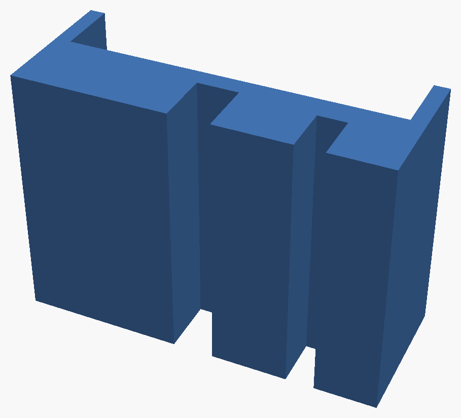 | 2 | Top cap's end, with its lips. One piece serves both top corners: turn it end for end for the sash's corner. Print two to try both at once | 60.8 × 20 × 40 | Standing, cross-section on the bed |
| `corner_bottom` | 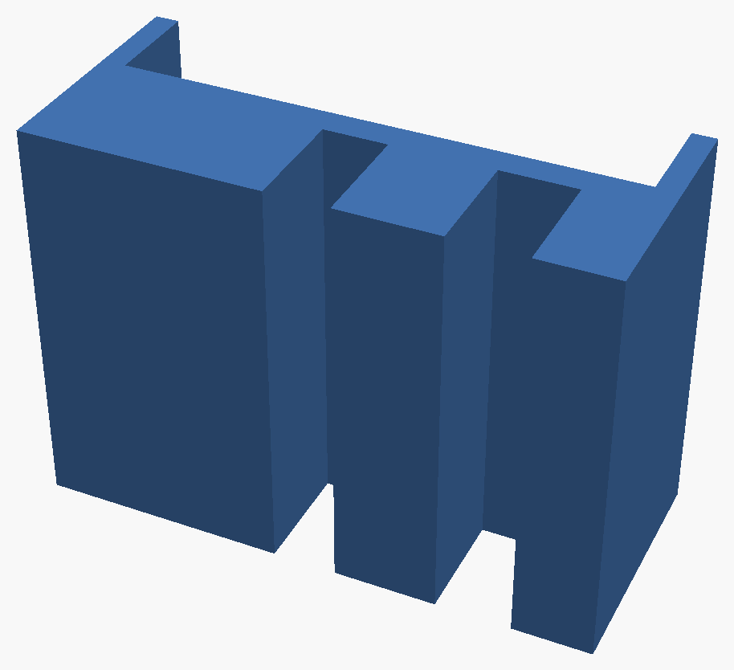 | 2 | Bottom cap's end, the same way | 60.8 × 22.5 × 40 | Standing, cross-section on the bed |
| `corner_side_top` | 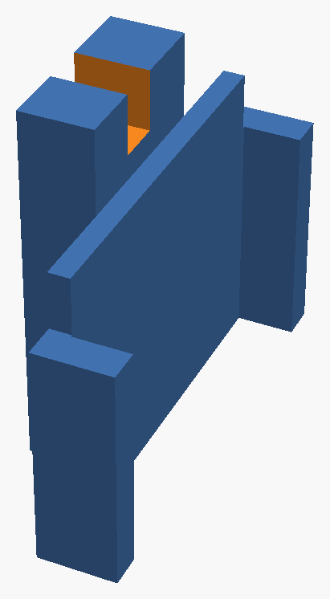 | 1 | Side cap's top end, under the top cap's lips; its tongue goes on to the ceiling, notched for the centre rib | 21.2 × 60.8 × 51.5 | Cut end on the bed, tongue up |
| `corner_side_bottom` |  | 1 | Side cap's bottom end; its tongue goes on to the floor, notched for the centre rail and the soft foam strip, and stopping 3.0 mm above the floor, over the floor strip | 21.2 × 60.8 × 51.5 | Cut end on the bed, tongue up |
| `corner_sash_top` |  | 1 | Sash cap's top end: the channel for the sash and the groove tongue, shallower over the screw head; the channel's walls go on to the ceiling, the room-side one notched for the room-side rib | 21.7 × 60.8 × 51.5 | Cut end on the bed, walls up |
| `corner_sash_bottom` |  | 1 | Sash cap's bottom end, the groove tongue shallower over the screw head; the channel's walls go on to the floor, the room-side one notched for the room-side rail | 21.7 × 60.8 × 54 | Cut end on the bed, walls up |

**Latch test.** A 3 mm slice of the side cap at the latch zone's mid-height, printed flat: the tongue, the base and the outdoor lip, the room side cut away from u = 17.9. Press its tongue into the side frame's channel and slide it to the latch: the latch must clear the cut edge, rather than reprinting `side_2a` and `side_2b` to find out.

| Part | Image | Qty | Description | Size (mm) | Print orientation |
|---|---|---|---|---|---|
| `latch_slice` |  | 1 | Side cap's section through the latch zone | 21.2 × 48.3 × 3 | Flat |

**Joint test.** Both ends of the second joint (432 mm above the floor) in the side and sash caps (24 mm each for the side cap, 35 mm for the sash cap's deeper sockets), with their joiners. Push a joiner into the lower end until it clicks, then push the upper end onto it. The upper ends print standing on their socket end, the lower ends with it on top: the real segments have both. `joint_tests` puts all of them on one plate, about 176 × 61.

| Part | <div style="width:180px">Thumbnail</div> | Qty | Description | Size (mm) | Print orientation |
|---|:---:|---|---|---|---|
| `joint_side_lower` | 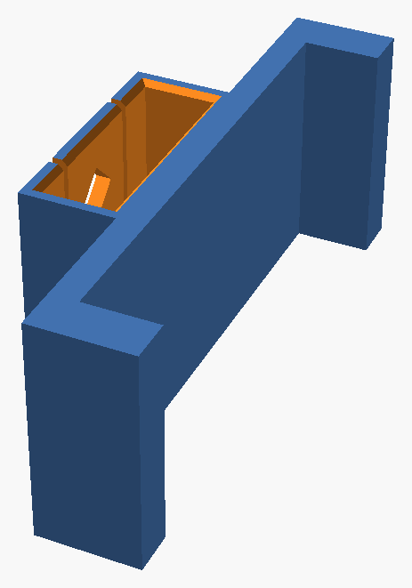 | 1 | Side cap below a joint: the socket in its tongue, with the snap tab and its window on the tongue's back face | 21.2 × 60.8 × 24 | Standing, socket up |
| `joint_side_upper` | 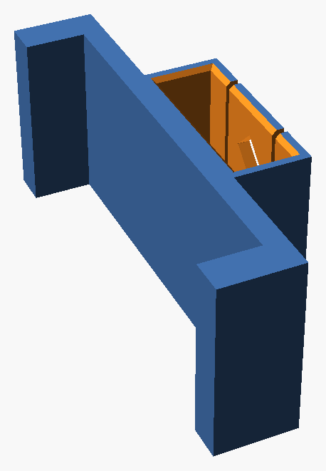 | 1 | Side cap above a joint (seen from below) | 21.2 × 60.8 × 24 | Standing on its socket end |
| `joint_sash_lower` | 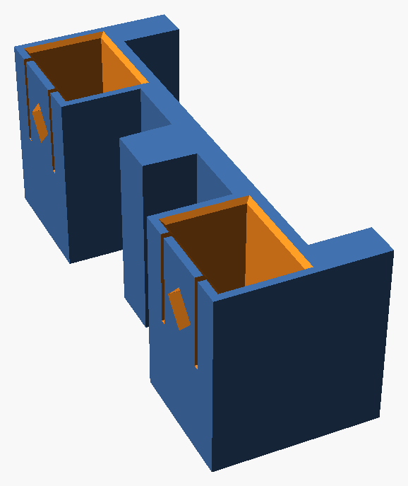 | 1 | Sash cap below a joint: a socket in each wall, the snap tab on the wall's free end | 21.7 × 60.8 × 35 | Standing, sockets up |
| `joint_sash_upper` | 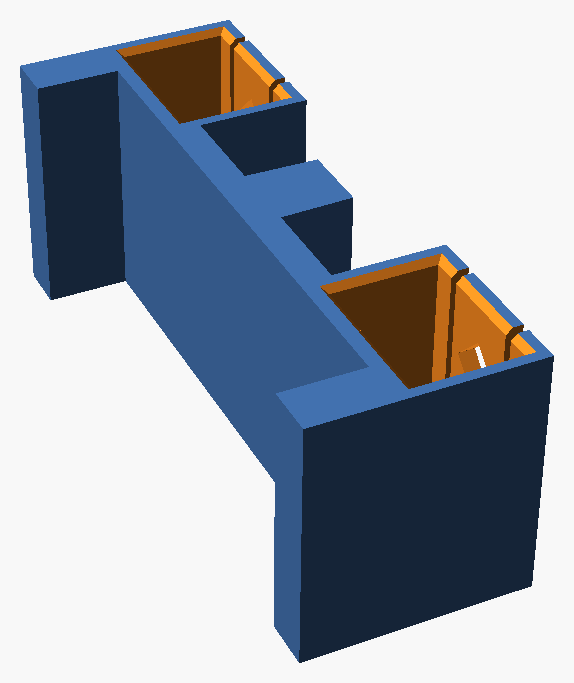 | 1 | Sash cap above a joint (seen from below) | 21.7 × 60.8 × 35 | Standing on its socket end |
| `joiner_side` | 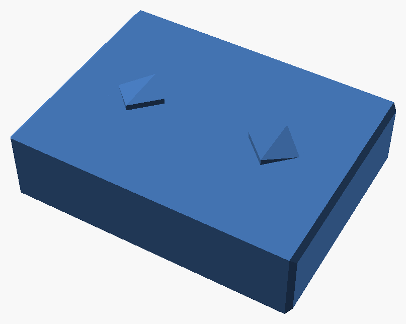 | 1 | Joins two side cap pieces. A bump near each end clicks into the window in a socket's tab: its steep face holds, its ramp leads in | 32 × 21.9 × 8.4 | Flat, bumps up |
| `joiner_sash` | 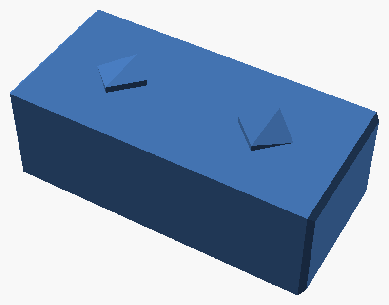 | 2 | Joins two sash cap pieces, one in each wall | 52 × 13.8 × 10.9 | Flat, bumps up |

**Snap test.** The smallest joint test, to feel the snap after changing the tab: the room-side wall of the sash cap's joint, both ends, and one `joiner_sash`, about 20 g. The full `joint_tests` also checks the side cap's joint. The tab is now 11.6 mm wide and 13 mm long (8 × 12 in the first joint test): more material beside the window, about the same flex, less strain at its root. The snap test passed: it snaps firmly, the tab is sturdy, and the joint comes apart and goes back together without breaking it. The sash cap's sockets have since gone from 15 to 25 mm deep, so its joint won't rock; the tab and the bump, measured from the segment's end, are unchanged.

| Part | <div style="width:180px">Thumbnail</div> | Qty | Description | Size (mm) | Print orientation |
|---|:---:|---|---|---|---|
| `snap_test` | 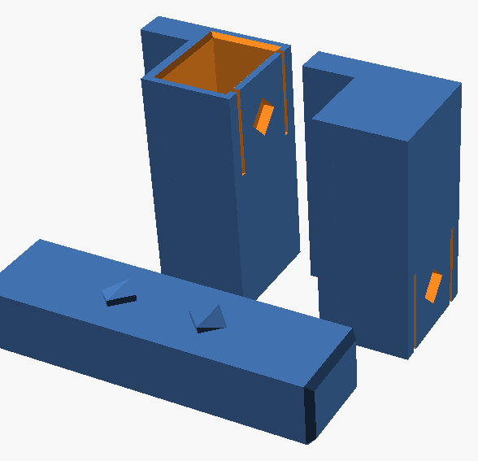 | 1 plate | One wall of a sash joint: the lower end (socket up), the upper end (socket down) and a joiner | 55 × 39 × 35 plate | As in `joint_tests` |

## Outdoor microphone

For the firmware's [audio mode](../firmware/README.md#wiring), the MAX9814 microphone module measures the sound level outdoors. It isn't weatherproof, and burying it in the foam wouldn't keep rain, condensation or frost off it, so it stays on the room side and only the sound comes through the foam, along an L:

- **The tube** goes straight through a 10 mm hole in the foam and stands out of its outdoor face. Its end there is cut at 45°, the top the longer side: a roof over the opening, which faces down and outward.
- **The elbow** is screwed to the foam's room face. It takes the tube's end and turns the sound path up, to the module's capsule, which points down into it. Neither rain nor dust can settle on the capsule. It prints in two parts, split level with its flange's top and joined by four M2 screws: the lower part lies on its flange, so the tube's socket is a vertical hole, and the upper part stands as installed, so the capsule's bore comes out round.
- **The tube's key:** a flat on top of its room end, in the elbow's socket, keeps the roof on top. Everywhere in the foam the tube is round, so it seals all around. Its end bears on the socket's bottom, a 45° cone, and an M2 screw through the elbow's side, tapped into the tube's wall, holds it there: the tube can't slide away into the foam.
- **The module** lies in a tray on top of the elbow, capsule side down, with a lid over it. The capsule is a light press fit in its bore, and the bore sets the module's position. The PCB lies on the tray's floor, 1.5 mm clear of its long walls, room for tweezers to lift it out, and 0.5 mm at its ends. The lid's rim clips into a groove in the tray's walls.

<p align="center">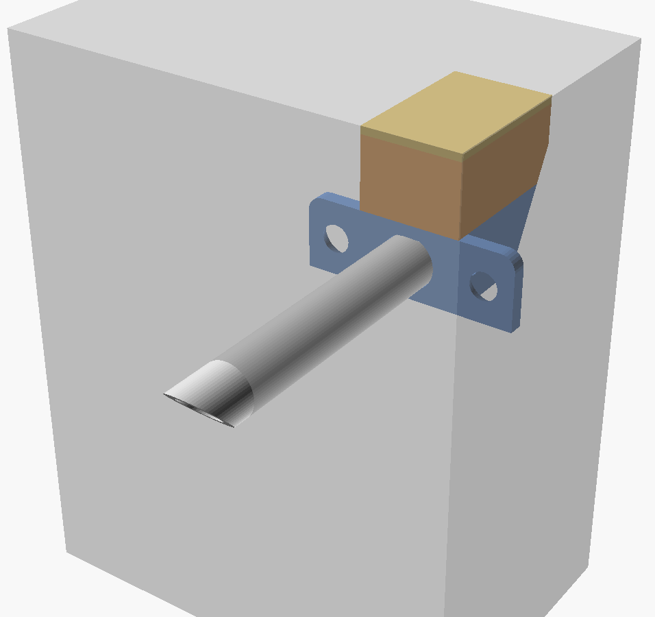</p>

**Installing it.** Put it above the vent unit, anywhere in the 96 mm of uncovered foam between the lips, clear of the vent's chassis and its electronics box.

1. Tap the lower part's four 1.6 mm holes M2, and screw the upper part on from inside the tray with four M2 × 6 countersunk screws. Tap the tube's 1.6 mm hole M2 too, gently: its wall is 1.7 mm.
2. Drill the 10 mm hole straight through the foam, square to its faces, with a long bit.
3. Push the tube in from the room side, cut end first, until its keyed end stands about 9 mm out of the room face, the flat on top.
4. Slide the elbow onto it, its flange flat on the foam: the socket's bottom pushes the tube home. Screw the flange on, then the M2 × 6 countersunk screw through the elbow's side into the tube. Snug it, don't force it: it holds the tube in only four threads.
5. Solder three wires to the module: VDD, GND and OUT, to J7's 3V3, GND and IN. Tie its GAIN pin to VDD (40 dB) and leave A/R open, as in the [firmware README](../firmware/README.md#wiring). Wires are better than a header: a straight header's pins would hit the lid.
6. Press the capsule into its bore, the wires out through the tray's notch, and press the lid on.

**Print `mic_bore_test` first.** Its three bores are 0.1, 0.2 and 0.3 mm over the capsule's 9.65 mm (one, two and three notches beside them). The elbow has the middle one, 9.85 mm (`cap_fit = 0.2`). If another holds the capsule better, set `cap_fit` to it and export the elbow's upper part again. A hole under each bore lets you push the capsule back out.

| Part | <div style="width:180px">Thumbnail</div> | Qty | Description | Size (mm) | Print orientation |
|---|:---:|---|---|---|---|
| `mic_tube` | 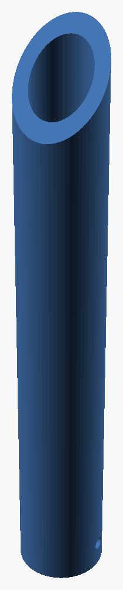 | 1 | The tube: 10.4 outside, 7 inside, through the foam and 12 mm past its outdoor face (1.6 mm at the bottom of the 45° cut). Its last 9.1 mm on the room side, in the elbow, has a 0.5 mm flat on top, and a 1.6 mm hole on its side to tap M2 | 10.4 × 10.4 × 71.9 | Standing on its room end, the cut on top. A 5 mm brim helps |
| `mic_elbow_lower` | 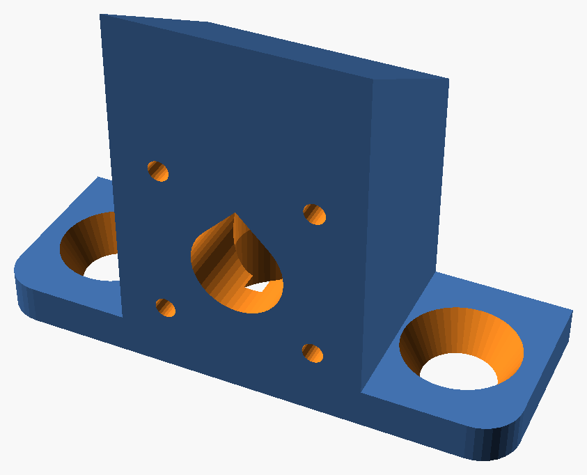 | 1 | The elbow's lower part: the flange, with 2 countersunk holes for the foam screws, the tube's socket, its bottom a 45° cone, and the start of the sound path, which turns up as a teardrop. Four 1.6 mm holes, 4.5 mm deep, to tap M2, and on its side a countersunk M2 clearance hole into the socket, for the tube's screw | 43 × 14.6 × 28.1 | Lying on its flange: the socket is a vertical hole, the teardrop's point up |
| `mic_elbow_upper` | 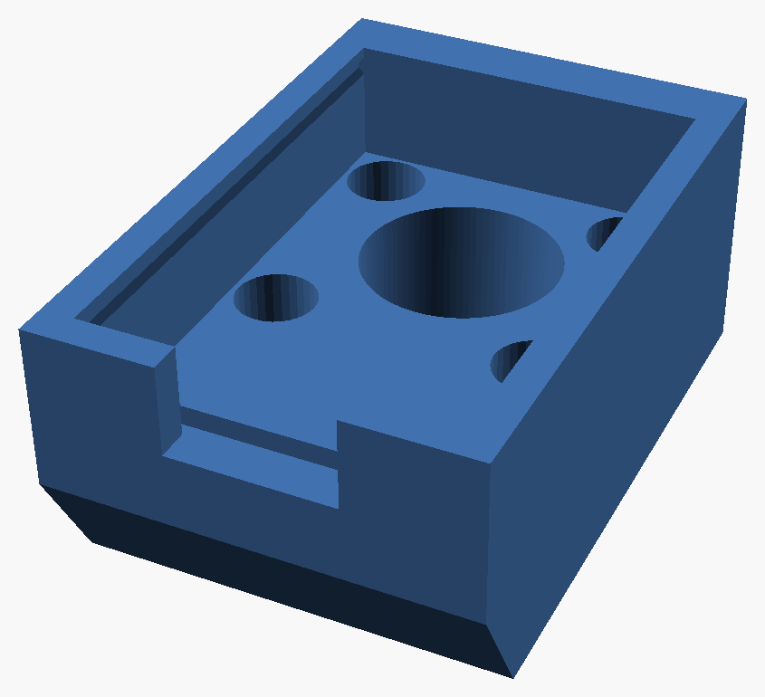 | 1 | The elbow's upper part: the sound path up to the capsule's 9.85 mm bore, the tray for the module (a groove under the header's holes for their solder, a notch for the cable, a groove along the long walls for the lid's clip), and four countersunk M2 holes in the tray's floor, in pockets under the PCB | 20.7 × 31.3 × 13.7 | Standing as installed, on the split: the capsule's bore comes out round. The slope under the tray is 45° or steeper |
| `mic_lid` | 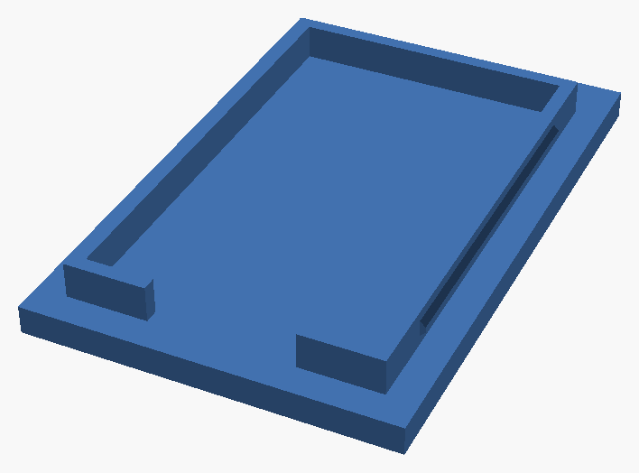 | 1 | The tray's lid: its rim 0.1 mm inside the walls, clear of the module's parts, with a 0.3 mm 45° ridge on each long side that clips into the walls' groove | 20.7 × 31.3 × 3.6 | On its top, rim up |
| `mic_bore_test` | 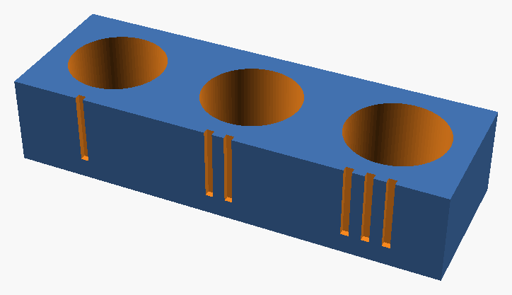 | 1 | Three capsule bores, 9.75, 9.85 and 9.95 mm, as deep as the elbow's | 44 × 14.6 × 8.3 | Flat |

| Item | Qty | Use |
|---|---|---|
| Short screws, countersunk, 8 mm head | 2 | The elbow's flange, into the foam: the latch cover's screws |
| M2 × 6 countersunk screws, and an M2 tap | 5 | Four joining the elbow's two parts: about 2 mm through the upper part, 4 mm into the lower one. One through the elbow's side into the tube |
| PETG filament | About 20 g | All four parts |

## Slicer settings

For a 0.4 mm nozzle. The caps print standing, the joiners flat.

| Setting | Caps and test pieces | Joiners | Why |
|---|---|---|---|
| Material | PETG | PETG | PLA turns brittle in the cold |
| Layer height | 0.2 mm | 0.2 mm | |
| Walls (perimeters) | 3 | 4 | The snap tab's 1.6 mm wall is then solid |
| Top and bottom layers | 4 | 4 | |
| Infill | Gyroid, 10 to 15 % | Gyroid, 40 % | See below |
| Supports | None | None | Every overhang is 45° or less: diamond windows, gabled socket ends |
| Brim | Outer only, 20 mm | None | A piece is up to 118 mm tall on a footprint about 21 × 61 mm: without a brim, a cap came loose and fell. Leave 15 mm between parts |
| Elephant's foot compensation | 0.2 mm, if the slicer has it | | The sockets' mouths are chamfered too |

**As printed.** The settings that printed the full side cap, in Bambu Studio's names, for the caps and the segments (not the joiners):

| Bambu Studio setting | Value |
|---|---|
| Brim type | Outer brim only |
| Brim width | 20 mm |
| Brim-object gap | 0 mm (at 0.1 mm, a tall segment tore away from its brim) |
| Wall loops | 3 |
| Sparse infill density | 10 % |
| Sparse infill pattern | Gyroid |
| Object-to-object distance | 15 mm |

**Infill.** The caps insulate with the air trapped in their infill, and only the plastic that bridges the cold and warm faces conducts heat. So density matters more than pattern: keep it low, and keep the walls to 3.

- Printed standing, the infill's channels run along the cap, not across it: heat crosses them and never runs along them.
- Cells a few millimetres wide (10 to 15 %) are too narrow for the air inside to circulate (convection needs gaps of 10 to 15 mm), so the trapped air insulates like closed cells.
- Gyroid has no straight bridge from one face to the other. Grid and rectilinear patterns do, and plain honeycomb doubles its walls, which adds plastic. 3D honeycomb was considered, but its cells aren't closed either, and it's more complicated.
- To close the channels completely, most slicers can add a solid infill layer every 20 to 30 mm ("solid infill every n layers"). It isn't needed, for the reason above.
- In perspective: the window's aluminium frame and sash conduct about 800 times better than PETG. Sealing the joints with tape matters more than the infill.

## Files

```
cad/window_caps.scad          parametric model of the caps and their test pieces (Customizer;
                              part = "assembly_view" for all of it, explode = 50 to spread it apart)
cad/mic_tube.scad             the outdoor microphone's tube, elbow (two parts) and lid (part = "mic_view")
stl/                          the test pieces, the full caps and the microphone's parts, exported
doc/window_top_view.svg       the window's profiles at mid-height, seen from above, to scale
doc/window_side_view.svg      the window's profiles across the foam, at the side frame, to scale
doc/insert_width.svg          the widths across the window: caps, lips, uncovered foam, vent chassis
doc/latch_template.pdf        the latch cover's notch, full size (and .svg): print at 100 %
images/                       part thumbnails and assembly views used in this README
tools/window_profiles_svg.py  draws the drawings in doc/ from the measurements in it (the same
                              values as in cad/window_caps.scad)
tools/latch_template_svg.py   draws doc/latch_template.svg and .pdf, and its preview
tools/render_images.py        regenerates the thumbnails in images/ from the model
```

To export a part from the command line:

```
openscad -o stl/corners.stl -D 'part="corners"' cad/window_caps.scad
```

## License

Part of the window vent: released under the same [CERN Open Hardware Licence Version 2 - Permissive](../LICENSE) (CERN-OHL-P-2.0).
