# Window insert for the air conditioner

A window insert like the [vent's](../README.md), for the exhaust hose of a portable air conditioner, for the summer. It goes in the same window, in the same way: printed caps on its four edges fit it to the window's profiles, and the insert itself is a stack of hollow printed boxes. One of them has the same hole as the air conditioner's own window panel, and the hose's end clips into it.

<p align="center">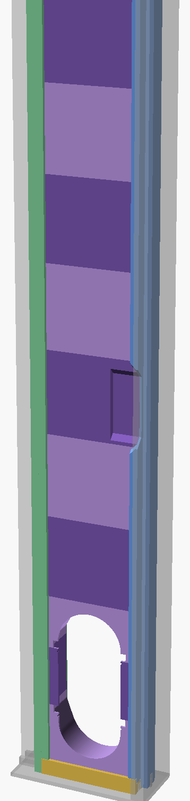</p>

> **Status: designed, not printed yet.** The hose's hole is checked: a test plate printed from the drawing matches the original panel. The top and bottom caps and the boxes are new and untested. The side and sash caps are the vent insert's, unchanged.

## How it works

- **Wider than the vent's insert:** 136 mm from the side cap to the sash cap (the vent's insert: 112), so 120 mm of the room face is uncovered between the caps' lips. The hose's end needs 115 at least. The sash stays open 142 mm.
- **Top and bottom caps:** the vent insert's, 142 long instead of 118.
- **Side and sash caps:** the vent insert's, unchanged: reuse them. They don't depend on the insert's width.
- **The boxes:** eight, stacked between the top and bottom caps, 50.8 thick like the vent's insert, and 0.5 narrower than the gap (135.5), so the sash still closes on them. Each is a thin shell with two inner walls parallel to its faces: the three air gaps insulate in series, like a triple-glazed window. Above the AC box they are 114.3 tall, short enough to print steadily. Box 3 is notched around the window latch; with eight boxes, no joint between them runs through the notch (the model warns if one does).
- **The AC box** (box 0, at the floor, so the hose's hole is as low as it goes): 250.3 tall, the hose's hole in a 2.83 mm panel on its room face, the thickness the hose's end clips onto. Behind the panel a tunnel runs out through the box: the hole's outline (its hull) grown by 5 mm, room for the clips. The hole's bottom edge is 37.35 above the floor, 14.85 above the bottom cap's lip: the hose's end needs at least 12.85 of free face below the hole (its top and bottom lips are wider than its side ones), plus a 2 mm margin. It prints in three pieces that snap together.

<p align="center">
  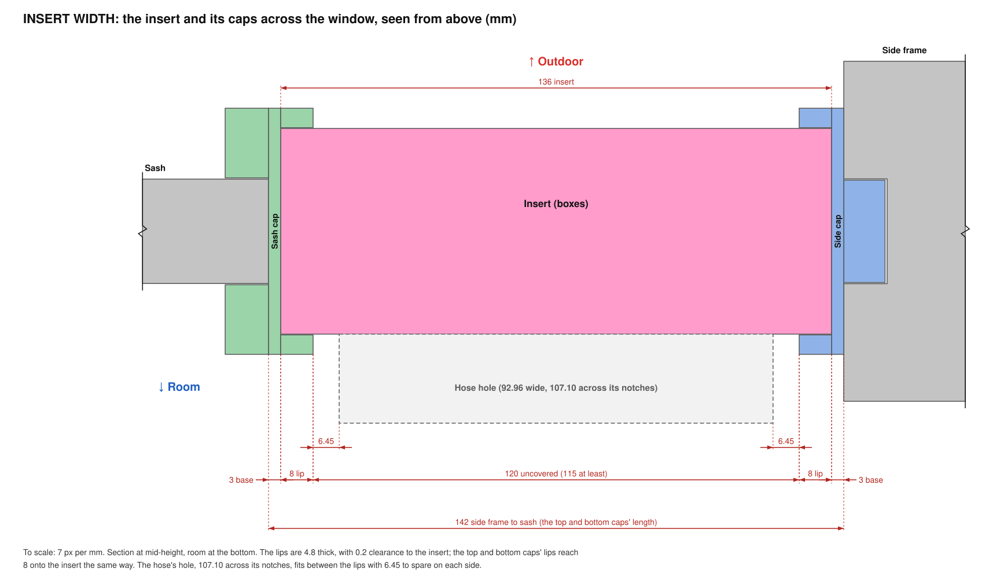
</p>

## The hose's hole

The hole in the air conditioner's panel, traced in pen on 1 mm paper, then redrawn in Visio just outside the pen line. `cad/ac_hole.scad` takes its dimensions from that drawing, in mm, with both sides made equal (the drawing's grid snapping left them a few hundredths apart). A test plate printed from it matched the original panel:

- **The hole:** a slot with semicircular ends, 92.96 wide and 211.28 tall.
- **Notches:** a pair on the sides, 11.00 tall and 7.07 deep (107.10 across the pair). On the drawing's 116 × 224 plate, their tops are 53.34 and 149.10 below its top edge, and the hole's top 6.02.
- **Bumps:** a small round bump on each side below each notch, 2.96 long and 1.54 deep, centred 67.98 and 163.83 below the plate's top edge.
- **The panel:** 2.83 thick, for the hose's end to clip.

The hole isn't symmetric top to bottom: the notches are nearer the top.

## The window's measurements

The same window as the vent's: see [its measurements](../README.md#the-windows-measurements). The drawings here show the wider insert.

<p align="center">
  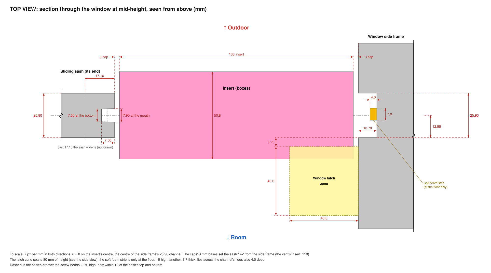
</p>

<p align="center">
  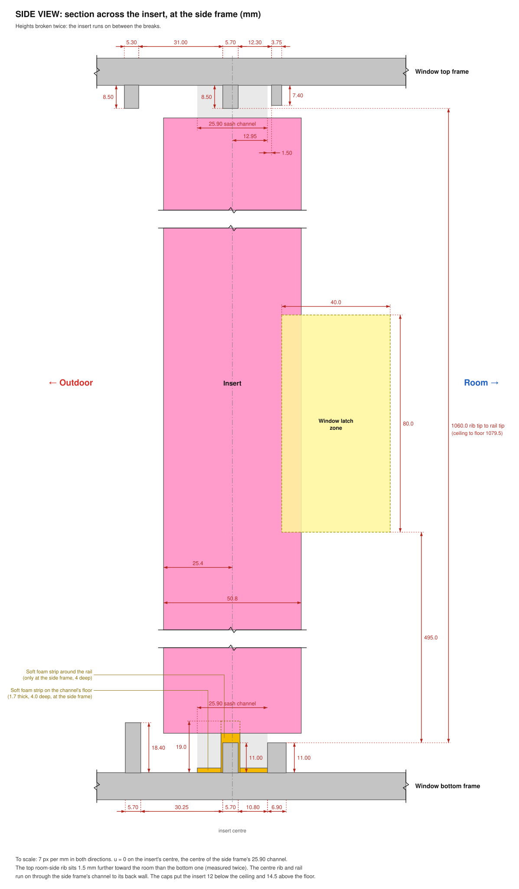
</p>

## Parts

### To print

Print in PETG, with no supports. The STLs in [`stl/`](stl) are exported in their print orientation.

| Part | <div style="width:180px">Thumbnail</div> | Qty | Description | Size (mm) | Print orientation |
|---|:---:|---|---|---|---|
| `cap_top` | 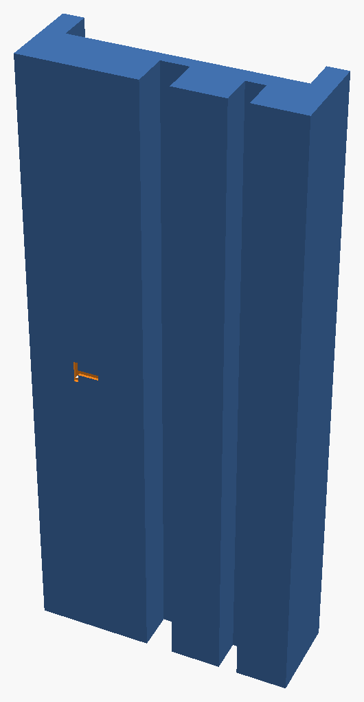 | 1 | Top cap, whole: the vent insert's, 142 long | 60.8 × 20 × 142 | Standing on its end |
| `cap_bottom` | 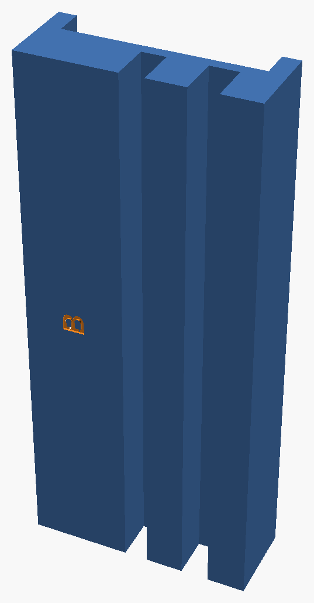 | 1 | Bottom cap, whole: the vent insert's, 142 long | 60.8 × 22.5 × 142 | Standing on its end |
| `side_0a` to `side_4b` |  | 1 each | Side cap's pieces, from `side_0a` at the floor; `side_2a` and `side_2b` have the relief around the window latch. **Reused from the vent insert:** the STLs are in [`../stl/`](../stl), labelled F0a to F4b. Shown: `side_0a`, turned over | 21.2 × 60.8 × 105 to 108 | Standing; `side_0a` and `side_2b` turned over, on their upper end |
| `sash_0a` to `sash_4b` |  | 1 each | Sash cap's pieces, from `sash_0a` at the floor. **Reused from the vent insert:** the STLs are in [`../stl/`](../stl), labelled W0a to W4b. Shown: `sash_0a`, turned over | 21.7 × 60.8 × 107 to 108 | Standing; `sash_0a` turned over, on its upper end |
| `joiners` | 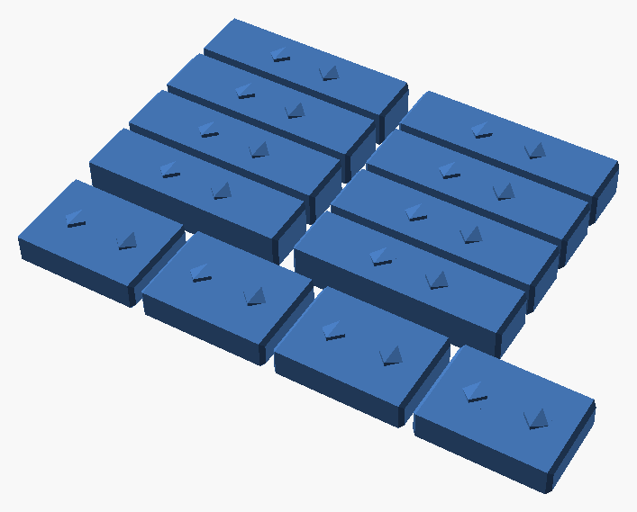 | 1 plate | The side and sash caps' joiners: 9 for the side cap, 18 for the sash cap. **Reused from the vent insert:** [`../stl/joiners.stl`](../stl/joiners.stl) | 168 × 146 plate | Flat, bumps up |
| `box_0a` | 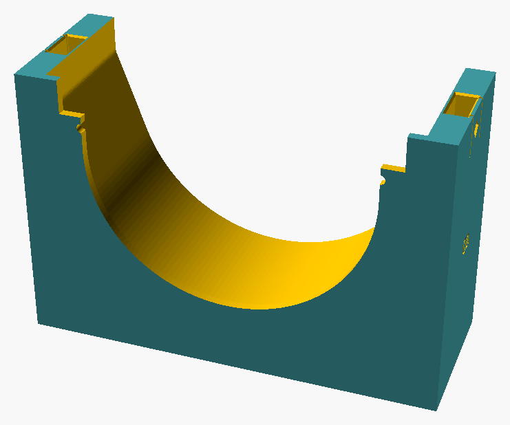 | 1 | The AC box's bottom piece: the lower arc and the lower notches, up to the notches' top edge | 135.5 × 50.8 × 91.1 | Standing, as installed |
| `box_0b` | 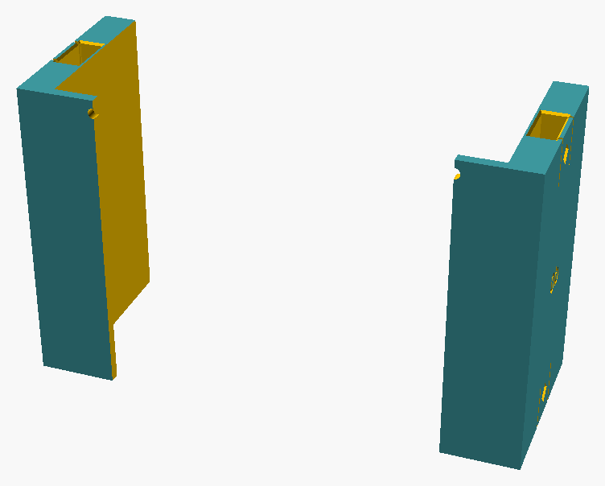 | 1 | The AC box's middle piece: two pillars beside the hole's straight sides, with the upper bumps | 135.5 × 50.8 × 84.8 | Standing, as installed |
| `box_0c` | 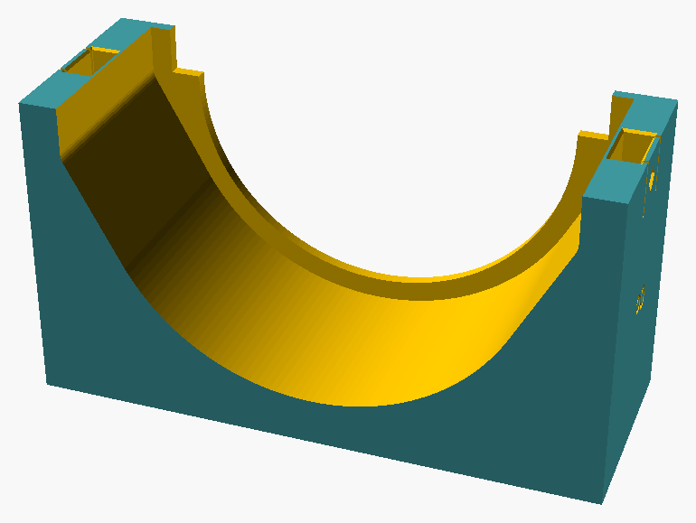 | 1 | The AC box's top piece: the upper notches and the upper arc, with 10 mm of material over the tunnel (`ac_cap`): its bed face | 135.5 × 50.8 × 74.5 | Upside down, on its top |
| `ac_joiners` | 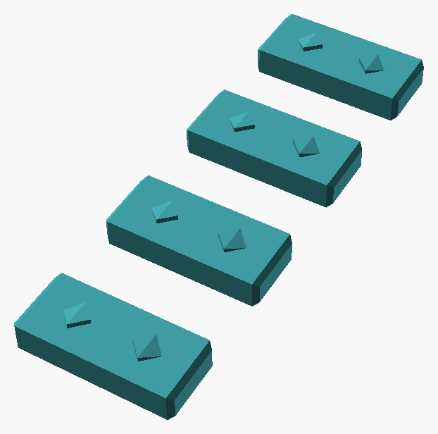 | 1 plate | Four snap joiners, the caps' design: one in each pillar at each joint of the AC box | 32 × 13.8 × 7.2 each | Flat, bumps up |
| `box_1`, `box_2`, `box_4` to `box_7` | 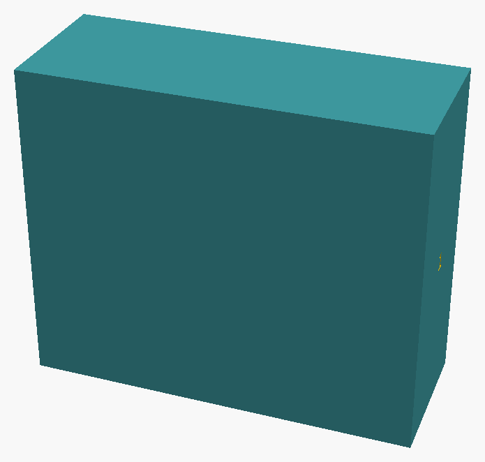 | 1 each | Plain boxes | 135.5 × 50.8 × 114.3 | Standing |
| `box_3` | 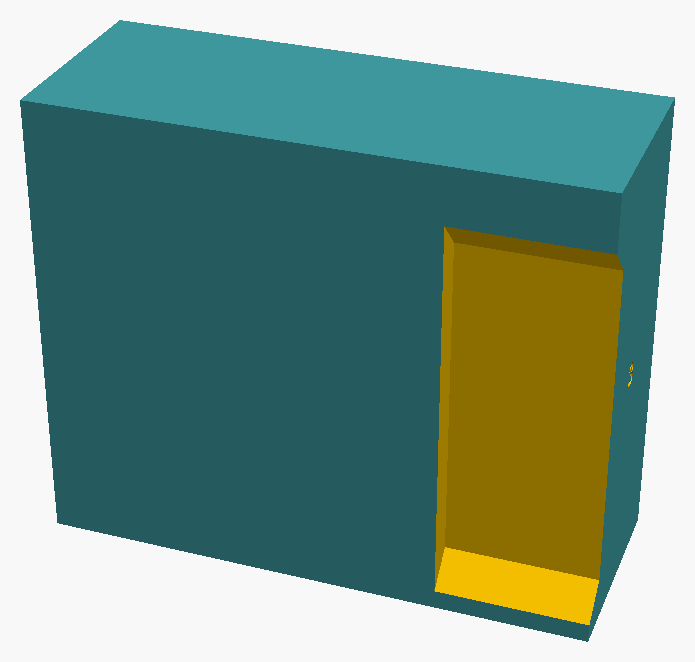 | 1 | Notched around the window latch | 135.5 × 50.8 × 114.3 | Standing |
| `hole_test` | 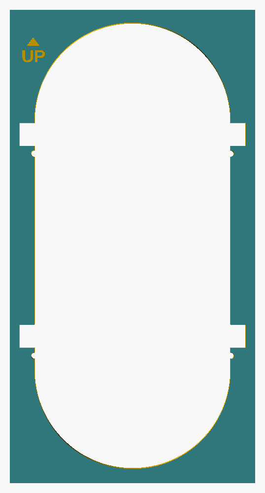 | 1 | The hole in a 116 × 224 plate, "UP" engraved in its upper left corner: try the hose's end in it before printing the AC box | 116 × 224 × 2.83 | Flat |

The side and sash caps and their joiners don't depend on the insert's width: if they are printed for the vent's insert, the same pieces serve both. Their print settings are in the [vent insert's README](../README.md#to-print).

**The AC box's pieces.** A hole through a standing box would have flat overhangs over the hole and its tunnel, so the AC box is cut where none is left: through the upper notches' bottom edge and the lower notches' top edge. The top piece prints upside down, so both arcs print as bowls, and each notch starts as a step in the wall. The middle piece is two pillars, as any slice through a hole would be.

**Joining them.** The three pieces snap together with the caps' joint: a socket in each pillar at each joint, 15 mm deep into each piece, in the middle of the box's thickness, and a joiner across it. The socket is the sash cap's, 14 mm wide: with its walls it fills only the middle air gap, so the outer gaps stay whole and no solid plastic crosses the box from face to face. A bump near each end of the joiner clicks into a diamond window in a tab of the socket's wall; the tab is the box's end face, the one against the side or sash cap. Around each socket the pillar is solid. Snap the joiners into `box_0a`, push the pillars of `box_0b` onto them, then the next two joiners and `box_0c`. Print `ac_joiners` with the side cap's joiner settings: 4 walls and 40 % infill.

**Labels.** Each box is engraved with its number on its side-frame end, the face against the side cap: 0a, 0b, 0c, then 1 to 7 from the floor up. It reads upright as installed, so the ones printed upside down read upside down on the bed.

**Boxes.** Their walls are the model's own (1.2 mm faces, 0.8 mm inner walls), so the slicer fills them solid: infill doesn't matter. Each cell's roof is a short bridge between two 45° corbels.

### To buy

| Item | Qty | Use |
|---|---|---|
| Thin foam tape (weatherstrip) | About 1 m | In the top frame's channel (2 or 3 mm), and between the caps' ends |
| Tape that peels off cleanly | About 2.5 m | Over the joints between the lips and the boxes on the room side, for drafts |

## Installation

Like the [vent's insert](../README.md#installation), like a drawer: nothing is glued.

1. Open the sash wider than usual.
2. Push the side cap, its pieces snapped together, into the side frame's channel.
3. Set the bottom and top caps on their rails and ribs, and slide them against the side cap.
4. Snap the AC box's three pieces together (`box_0a`, `box_0b`, `box_0c`, with the joiners).
5. Slide the boxes in sideways, between the caps' lips, into the side cap, from the floor up: the AC box, then boxes 1 to 7, by the numbers on their side-frame ends. The top box holds the top cap up.
6. Put the sash cap on the boxes' other end, and close the sash against it.
7. Tape over the joints between the lips and the boxes on the room side, for drafts.
8. Clip the hose's end into the AC box's panel from the room.

## Files

```
cad/ac_hole.scad              the hose's hole (ac_hole(), 2D), its panel's thickness, the test plate
cad/window_caps.scad          the caps (Customizer; part = "assembly_view" for all of them, with the
                              insert as a ghost): the vent insert's, for the wider insert
cad/insert_boxes.scad         the boxes and the AC box's pieces (part = "box_view": the whole stack)
stl/                          the parts to print, exported
doc/window_top_view.svg       the window's profiles at mid-height, seen from above, to scale
doc/window_side_view.svg      the window's profiles across the insert, at the side frame, to scale
doc/insert_width.svg          the widths across the window: caps, lips, uncovered face, hose's hole
images/                       part thumbnails and the stack's view used in this README
tools/window_profiles_svg.py  draws the drawings in doc/
tools/render_images.py        regenerates the images in images/ from the model
```

To export a part from the command line:

```
openscad -o stl/box_0a.stl -D 'part="box_0a"' cad/insert_boxes.scad
```

## License

Part of the window vent: released under the same [CERN Open Hardware Licence Version 2 - Permissive](../../LICENSE) (CERN-OHL-P-2.0).
